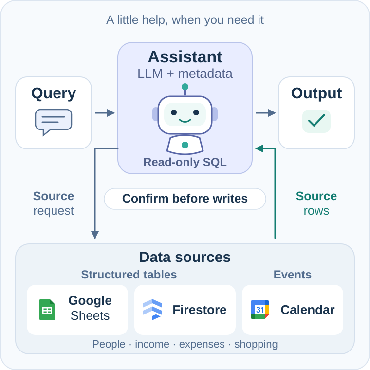

# LINE Personal Assistant

A Thai LINE assistant that answers questions about your records and prepares
changes for your confirmation. It works with Google Sheets, Firestore and Google
Calendar: expenses, appointments, people, income and other configured tables.

## Example conversations

These are illustrative conversations with synthetic data, not captured model
outputs. Available tables and optional features depend on configuration.

**Ask and follow up**

```text
You:       เดือนตุลาคม 2026 รายการไหนบ่อยสุด
Assistant: รถไฟฟ้า 13 ครั้งครับ
You:       รวมเป็นเงินเท่าไหร่
Assistant: รถไฟฟ้าในเดือนตุลาคม 2026 รวม 130 บาทครับ
```

The follow-up uses the delivered question context and reads fresh records.

**Review before saving** — assuming both names already exist in the catalog:

```text
You:       กาแฟ 35 บาท และรถเมล์ 20 บาท วันที่ 31 ต.ค. 2026
Assistant: [Review: 31 Oct 2026, coffee 35 THB, bus 20 THB; save/cancel controls]
You:       บันทึก
Assistant: [Saved receipt for the two entries]
```

**Complete an appointment**

```text
You:       เพิ่มนัดนิทรรศการทดสอบวันที่ 10 พ.ย. 2026
Assistant: นิทรรศการทดสอบ เป็นนัดทั้งวัน หรือเริ่มกี่โมงครับ?
You:       ทั้งวัน
Assistant: [All-day review for 10 Nov 2026; confirmation controls]
```

The last example prepares a review; the event is created after confirmation.
See [behavior and supported limits](docs/behavior.md) for more examples.

## What makes it useful

- **Questions across records.** Filter, rank, group and join configured tables;
  calculate daily spending or compare income with people records. New ordinary
  schemas use metadata on supported adapters instead of a query handler per table.
- **Changes with a review.** Prepare table inserts, updates and deletes, log
  expenses, and create appointments. Optional workflows cover saved-record
  corrections, catalog aliases and category review.
- **Interrupted conversations.** Keep pending work across questions and restarts.
  Delivered reviews, versions and durable receipts govern confirmation and replay.

The model chooses sources, query meaning and proposed fields. Python reads the
configured sources, computes results with read-only SQL and checks changes.
Checking execution does not prove that the model understood every condition;
[semantic evaluation](benchmarks/intent-v2/README.md) is separate from code tests.

## Try the local mock

Use Python 3.11+ and run from the repository root:

```sh
python3 -m venv .venv
. .venv/bin/activate
python -m pip install -r requirements.lock
python -m pip install --no-deps -e .
python -m uvicorn line_assistant.main:app --host 127.0.0.1 --port 8000
```

Open `http://127.0.0.1:8000/health` to check mock mode.
This entry point uses deterministic mocks without real
credentials or model calls. It demonstrates application plumbing; it does not
exercise live LLM interpretation. The signed, history-enabled factory is a
separate opt-in described in [deployment](docs/deployment.md).

To run offline tests, install the development dependencies first:

```sh
python -m pip install -r requirements-ci.txt
PYTHONDONTWRITEBYTECODE=1 python -m pytest tests -p no:cacheprovider
```

The suite blocks external sockets. See the [test guide](tests/README.md) for
focused checks, packaging and what each kind of evidence establishes.

## Architecture at a glance

[](docs/system-flow.md)

Reads normally follow `act` / `intent=read` → configured source snapshots →
read-only SQLite analysis → `act` / `intent=respond` with linked result facts.
Exploration, clarification and repairs can require more calls. SQLite is a
temporary calculation engine; business records stay in their configured store.

Writes follow proposal → delivered review → new owner confirmation → provider
effect and receipt. A read or model answer cannot authorize a write. Durable
actions and reconciliation handle replay and uncertain acknowledgements.

Built with Python, FastAPI, the OpenAI Responses API, SQLite and Google APIs;
hosted deployments use Cloud Run and Firestore state. The [architecture guide](docs/architecture.md)
contains the full stack and module map; [runtime diagrams](docs/system-flow.md)
show the boundaries in detail.

## Where to go next

| Your goal | Reading path |
| --- | --- |
| Understand the project | [Behavior examples](docs/behavior.md) → [Architecture](docs/architecture.md) |
| Change the code | [Development](docs/development.md) → [Module map](docs/architecture.md#module-map) → [Tests](tests/README.md) |
| Configure or deploy | [Configuration](docs/configuration.md) → [Storage](docs/storage-backends.md) / [table setup](docs/tables.md) → [Deployment](docs/deployment.md) |
| Understand reads | [Current read intents](docs/intents.md) → [SQL](docs/relational-queries.md) → [Source contracts](docs/read-queries.md) |
| Debug a conversation | [Action traces](docs/action-traces.md) → [Performance](docs/performance.md) → [Answer composition](docs/answer-composition.md) |

The [documentation index](docs/index.md) lists workflow and reference guides.
[Security](SECURITY.md) covers private data handling and vulnerability reports.

This README describes the source, not verified deployment status. The generic
table registry starts empty; optional workflows require configuration. A source
push runs offline CI and does not deploy the service. Scripted tests, fresh
synthetic inference and live release checks establish different things; see
[evidence boundaries](tests/README.md#offline-replay-and-fresh-model-evidence).

## License

A license has not been selected. No license file is currently provided.
