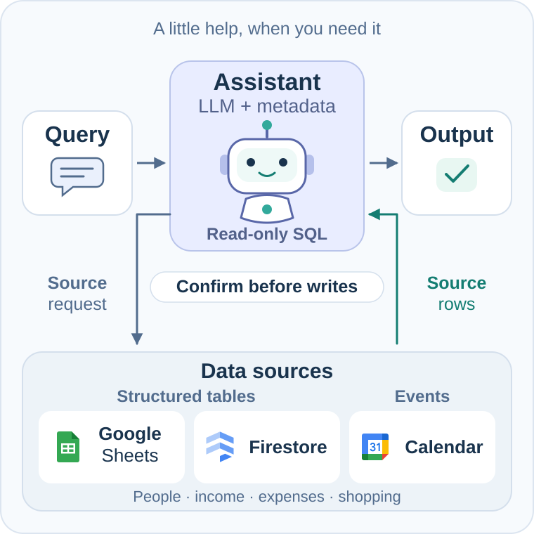

# LINE Personal Assistant

A personal LINE assistant for querying and maintaining structured data and Calendar appointments. It supports people, income, expenses, shopping lists and other metadata-defined tables. The project is designed for occasional use with small running costs; actual model and hosting costs depend on usage.

[](docs/system-flow.md)

The assistant treats structured records as **tables** and appointments as **Calendar events**. The LLM uses schema metadata to select sources, fetch records and propose SQL. Python executes the query and validates any proposed changes. Data stays in Google Sheets, Firestore or Google Calendar; SQL analysis runs over observed records in a temporary in-memory SQLite database.

## What it can do

- **Ask questions across data.** Filter, join, group, rank, compare and calculate running totals with SQL. Examples include daily spending with cumulative totals, income linked to people, or spending on dates selected from Calendar appointments.
- **Maintain structured records.** Prepare inserts, updates and deletes for configured tables, including records with no date or amount columns. A new ordinary table uses metadata and an existing supported storage binding, without another table-specific query function.
- **Manage appointments.** Read accessible calendars, prepare timed or single-date all-day events, and reschedule saved appointments when the relevant feature is enabled. Calendar retains its event/time tools and provider rules.

Expenses are one supported workflow, with catalog-name resolution, category choices, multiple entries and reviewed saving. Income belongs in a configured income table. The assistant asks which destination to use when the available metadata does not establish a unique one. The generic table registry is empty by default; startup does not create tables or discover unconfigured databases.

## How it works

1. **Understand the request and schema.** The planner sees dialogue, original timestamps, pending work, available tools and configured source metadata: purpose, columns, types, units, relationships and allowed operations.
2. **Read the necessary records.** Source tools retrieve complete matched records from configured Sheets/Firestore tables and readable calendars. The planner receives current-request references and the actual schemas in `relations_catalog`.
3. **Analyze with SQL.** `query_relations` is the main composable analysis layer. Read-only SELECT/CTEs support joins, CASE, HAVING, subqueries and window functions. Python computes results over all selected records before display limits. Simple reads can still use the existing typed tools directly.
4. **Prepare changes separately.** Typed table, expense and Calendar tools create reviewed proposals. Shared field patches update pending records; temporal plans compute date/time changes from verified sources. SQL cannot write or confirm a change.
5. **Confirm and execute.** A new owner confirmation must match the delivered review and version. Durable action IDs, provider versions and receipts govern execution, replay and uncertain outcomes.

See the [runtime diagrams](docs/system-flow.md), [SQL analysis guide](docs/relational-queries.md) and [table metadata guide](docs/tables.md).

SQL operates only on records actually read in the current owner turn. Incomplete sources do not establish complete totals, and a failed query cannot silently fall back to a different earlier answer. Recoverable planning errors return the actual schema and diagnostics to the model; repeated plans stop. Decimal sums and explicit decimal arithmetic helpers avoid implicit floating-point money calculations. Source permissions, provider windows, context, deadlines and accounting gates still apply.

## Data sources and workflows

Google Sheets and Firestore can store generic business records. [Table metadata](docs/tables.md) supplies their meaning and schema; a new storage provider still needs an adapter. The established expense/catalog workflow can use the [configured expense storage backend](docs/storage-backends.md). Firestore also holds internal history, state and recovery records separately from registered business collections.

Calendar creation targets one configured calendar. Optional [all-calendar reads](docs/configuration.md#reading-all-calendars) combine calendars readable by the runtime account, and owners can [connect shared calendars through LINE](docs/configuration.md#connect-a-calendar-through-line). Conflict checks cover the configured write calendar. Creation does not support guests, recurrence, reminders or multi-day all-day ranges. [Saved-record changes](docs/saved-record-edits.md) use separate feature flags and reviewed workflows.

Additional guides cover:

- [Pending-record patches](docs/pending-records.md) and [temporal plans/tool recovery](docs/temporal-plans.md).
- [Capability and data coverage](docs/data-inventory.md), [read examples](docs/read-queries.md) and [behavior](docs/behavior.md).
- Optional expense workflows: [provisional categories](docs/provisional-categories.md), [historical category review](docs/historical-categories.md) and [previous saved amounts](docs/previous-expense-prices.md). Proposed mappings remain distinct from confirmed records and final write consent.

This README describes the current source. Feature activation depends on configuration; a GitHub source push and a production deployment are separate actions.

## Technology stack

| Layer | Technology and role | Source |
| --- | --- | --- |
| Application | Python 3.11+, FastAPI, Uvicorn and Pydantic 2 serve the webhook and validate data/configuration. | [Dependencies](pyproject.toml), [app](src/line_assistant/main.py) |
| LINE | Messaging API events and replies, with HMAC signature and configured-owner checks. | [LINE adapter](src/line_assistant/line_api.py), [ingress](src/line_assistant/main.py) |
| Language model | OpenAI Responses API with `gpt-6-luna` interprets requests, proposes tools/SQL and optionally words grounded Thai replies. A model response cannot authorize a write. | [Model API](src/line_assistant/model_api.py), [runtime flow](docs/system-flow.md) |
| SQL analysis | Python's SQLite engine executes read-only queries over current-request snapshots, with decimal helpers and isolated connections. It is not the persistent business store. | [Relation schemas](src/line_assistant/relational.py), [SQL executor](src/line_assistant/relational_sql.py) |
| Business data | Google Sheets and Firestore store metadata-defined tables; Google Calendar stores appointments. Existing expense/catalog adapters retain their workflow. | [Table adapters](src/line_assistant/table_storage.py), [expense backends](docs/storage-backends.md), [Calendar adapter](src/line_assistant/calendar_provider.py) |
| HTTP and identity | `httpx` uses bounded provider REST clients and injectable test transports. Google access and version-pinned secrets use explicit configuration. | [HTTP boundary](src/line_assistant/pilot_http.py), [authentication](src/line_assistant/google_auth.py), [configuration](docs/configuration.md) |
| Durable state | Separate Firestore records hold owner leases, history, receipts, actions and model accounting. Local adapters support mocks and restart tests. | [Production state](src/line_assistant/production_history_state.py), [architecture](docs/architecture.md) |
| Hosting and build | A non-root container runs on Cloud Run. Cloud Build verifies reviewed source and publishes to Artifact Registry; Cloud Logging holds diagnostics. | [Dockerfile](deploy/history-production.Dockerfile), [build template](deploy/cloudbuild.json), [deployment](docs/deployment.md) |
| Tests and CI | pytest, signed synthetic webhooks, mock providers and temporary stores. GitHub Actions runs offline tests plus source/wheel/startup checks. | [Test guide](tests/README.md), [CI](.github/workflows/ci.yml) |

The raw-history runtime has no fixed model-call count per owner turn. Reads and analysis can continue across sources; repeated plans stop and configured request/accounting gates remain. Verified direct controls can skip the model. Reply wording and optional workflows have explicit flags. The critic in the [benchmark work](benchmarks/PROTOCOL.md) is not a runtime phase; engineering models are separate from the bot's runtime model.

The [database and field guide](docs/database-schema.md) distinguishes business schemas from internal state/history. [requirements.lock](requirements.lock) pins the installation snapshot; [requirements-ci.txt](requirements-ci.txt) adds wheel-build tools. A source push runs offline CI and does not build a cloud image or deploy the service.

## Run the local mock

Python 3.11 or newer is required. Run from the repository root:

```sh
python3 -m venv .venv
. .venv/bin/activate
python -m pip install -r requirements.lock
python -m pip install --no-deps -e .
python -m uvicorn line_assistant.main:app --host 127.0.0.1 --port 8000
```

`GET /health` reports mock mode. This local entry point uses deterministic mock integrations, has no real credentials and does not call a model. The signed, history-enabled production factory is a separate opt-in described in [deployment](docs/deployment.md). The `.env.example` file documents local configuration; files are never loaded automatically.

## Test

```sh
PYTHONDONTWRITEBYTECODE=1 python -m pytest tests -p no:cacheprovider
```

The [test guide](tests/README.md) explains the test families, representative cases,
setup commands, mocks, count interpretation and how to add a regression. The
checked-in suite denies external sockets and needs no paid API access. Packaging
checks also start the exact source archive in an isolated subprocess.

The [role benchmark protocol](benchmarks/PROTOCOL.md) separates development cases
from frozen held-out evaluation. See the [Luna baseline scorecard](benchmarks/v1/results/README.md);
human style ratings remain pending. The [inference validation protocol](docs/inference-validation.md)
explains separate synthetic real-model validation. Private model traces and
release-operation evidence are not part of this repository.

## Documentation

| Guide | Purpose |
| --- | --- |
| [Architecture](docs/architecture.md) | Request flow, module boundaries and persisted contracts |
| [Behavior](docs/behavior.md) | User examples and supported limits |
| [Read answers](docs/answer-composition.md) | Model-selected prose/layout, linked facts and compact fallbacks |
| [SQL analysis](docs/relational-queries.md) | Primary query layer, derived results, precision and read isolation |
| [Tables](docs/tables.md) | Sheets/Firestore metadata, relationships and reviewed changes |
| [Configuration](docs/configuration.md) | Explicit targets, feature flags and secret mounts |
| [Database and fields](docs/database-schema.md) | Sheet setup, field types, Firestore state and retention |
| [Development](docs/development.md) | Tests, source packaging and change review |
| [Test guide](tests/README.md) | Test families, examples, commands and evidence limits |
| [Deployment](docs/deployment.md) | Container startup, staging and compatible rollback |
| [Security](SECURITY.md) | Data handling and private vulnerability reports |

## Operational diagnostics

Hosted turns emit redacted [action traces](docs/action-traces.md) for model/tool
steps, validation codes and draft transitions. They use existing Cloud Run logs
and preserve the current confirmation and replay rules.
Failed expense preparation passes its actual validation diagnosis to reply
generation. Known enrollment failures can be explained in natural Thai while
retaining draft facts and asking only the missing category choice; an unknown
cause is reported honestly instead of blamed on the owner's input.

## License

A license has not been selected. No license file is currently provided.
