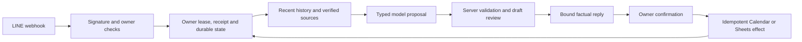

# Architecture

## Request flow

`main.py` validates the HMAC signature before parsing JSON or performing provider work. The production factory in `history_cloud_run.py` binds a single configured owner, attached service account, spreadsheet, optional secondary calendar and mounted secrets. Configuration cannot supply an arbitrary provider URL.

`history_first.py`, `raw_history.py` and the domain workflow modules interpret literal owner sources. Tool output is a proposal. The server certifies field sources, validates dates and amounts, and retains unchanged facts. A model response cannot confer consent or assert an external write succeeded.

## Module map

| Area | Modules |
| --- | --- |
| Ingress and composition | `main`, `cloud_run`, `history_cloud_run` |
| Target configuration and bounded HTTP | `pilot_config`, `pilot_http`, `calendar_transport` |
| Expense drafts and evidence | `draft_workflow`, `expense_sources`, `expense_evidence`, `catalog_names` |
| Calendar drafts and groups | `calendar_workflow`, `calendar_batches`, `calendar_event_types`, `calendar_sources` |
| Persistence and recovery | `firestore_state`, `production_history_state`, `history_persistence`, `raw_history` |
| Provider adapters | `sheets_api`, `calendar_provider`, `line_api`, `model_api` |
| Thai interpretation and factual replies | `language`, `history_dates`, `calendar_dates`, `response_realization` |
| Mock adapters and legacy compatibility | `adapters`, `mock_api`, `conversation_mocks`, `conversation`, `service` |

The older entry points and serializers remain for compatibility and focused offline tests. The history-enabled factory is the current application composition. Protocol and state identifiers such as versioned postbacks and `calendar-history-v2` are persisted contracts; they are not documentation release labels and must not be renamed casually.

## State and recovery

The owner lease fences concurrent effects. State records receipts, delivered review versions/nonces, action fingerprints, model reservations and uncertain outcomes. External actions are recorded before HTTP. Missing acknowledgements remain uncertain until positive reconciliation proves the outcome. Automatic blind retries are unsafe.

Raw message records are stored separately from the compact core snapshot. Recent model context uses a rolling 24-hour window and verified summaries; context expiry does not imply deletion of stored originals. Snapshot size limits stop the workflow rather than erase records. Optional legacy workbook bindings allow explicitly configured old state to be retained during migration.

An OFF bridge must run an image that understands every state schema the candidate can create. It retains history and pending actions while disabling Calendar execution. Traffic rollback preserves newer data and cannot undo an event already created in Google Calendar.
