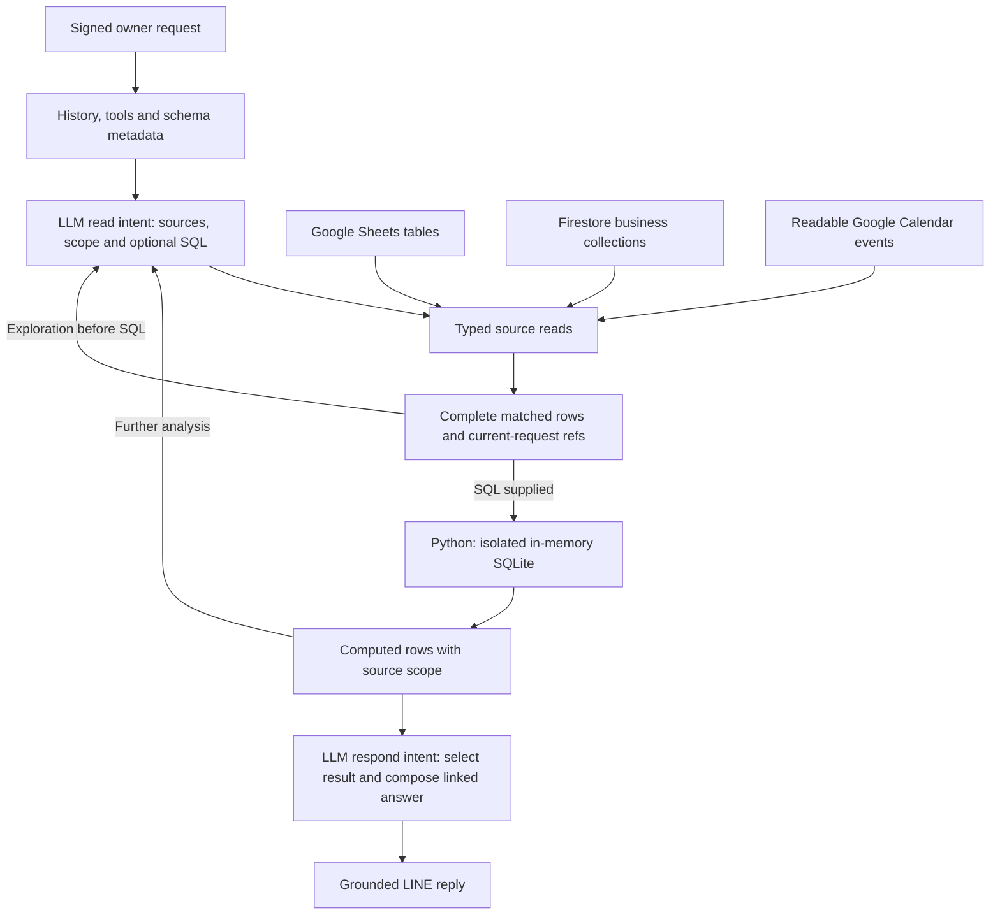

# Architecture

The assistant has two business-data abstractions: metadata-defined **tables**
and **Calendar events**. Tables can represent people, income, expenses, tasks
or shopping records in Google Sheets/Firestore. Calendar retains its own
interval, recurrence-read and event-version semantics.

The current planner uses `act` with `intent=read` to declare sources and optional
SQL together; `intent=respond` selects an offered result and composes its answer.
See the [current interface and compatibility map](read-queries.md#current-interface-and-compatibility).

The main analysis layer is read-only SQL over observed records. The LLM chooses
sources and query meaning; Python validates access, materializes complete
matched snapshots and executes the query. Simple typed reads remain available.
See the [runtime diagrams](system-flow.md), [SQL contract](relational-queries.md)
and [table registration](tables.md). The [planning prompt](planning-prompts.md)
uses shared principles and optional capability sections; parameter formats
belong to the tool schemas.

## Query path

The diagram shows logical stages, not separate model calls: one read intent can
include both source selection and SQL. `sql=null` permits exploration first.
The linked response path requires response realization and an eligible result;
other combinations and clarification can use `finish_query_analysis`.

`relations_catalog` describes actual columns, types, units, row counts and scope.
It is built from observed query results, not guessed from provider names. SQL
can compose joins, CASE, CTEs, subqueries and window functions without adding a
handler for each table/question. Decimal helpers support exact sums and explicit
rounding. Source reads can still be split into bounded windows. Display limits
do not restrict calculations; incomplete reads cannot prove complete totals.

SQLite is temporary computation, not a new persistent SQL database or a SQL
endpoint for Sheets/Firestore. Each call gets a new in-memory connection with
extensions disabled and a read/function authorizer. SQL cannot access provider
targets, files, internal state or write tools. Derived query references expire
with the owner turn. The model remains responsible for selecting the intended
filter/join/coverage semantics; see [SQL limits](relational-queries.md).

## Write path

```mermaid
flowchart LR
    Request[Signed owner request] --> Metadata[Configured schema and allowed operations]
    Metadata --> Model[LLM medium reasoning: typed field proposals]
    Model --> Validate[Python validates sources, types and versions]
    Validate --> Review[Delivered before/after or creation review]
    Review --> Owner[New owner confirmation]
    Owner --> Effect[Durable action and configured provider effect]
    Effect --> Receipt[Receipt or positive-proof recovery]
```

Generic table tools prepare insert/update/delete proposals. Expenses keep their
specialized name/category/evidence workflow; Calendar keeps event/time tools.
`patch_pending_records` updates owned pending fields across domains. Temporal
plans calculate dates/times from original owner evidence and verified bases.
Unchanged fields retain their proofs. Tool-declared argument errors return the
actual schema to the planner; repeated diagnostics stop. Preparation and SQL
cannot grant consent or prove that an external write succeeded.

Raw-history planning uses Luna `medium` with a shared reasoning/output allowance
of 32,768 tokens; summaries and reply composition retain `none`. Reservation and
response checks include reasoning in the output total. Planner HTTP may use up
to 30 seconds within a 50-second owner RPC scope; other RPCs retain their existing
limits. These are ceilings, not expected token usage or latency. No automatic
retry follows an incomplete or uncertain model response.

`main.py` checks the HMAC signature before parsing JSON/provider work.
`history_cloud_run.py` binds the owner, service account, private source targets,
feature flags and mounted secrets. Metadata can add ordinary schemas on existing
supported adapters; it cannot supply an arbitrary provider URL, create a
resource or grant access. The generic registry is empty by default.

## Technology stack

| Layer | Technology and role | Source |
| --- | --- | --- |
| Application | Python 3.11+, FastAPI, Uvicorn and Pydantic 2 serve the webhook and validate data/configuration. | [Dependencies](../pyproject.toml), [app](../src/line_assistant/main.py) |
| LINE | Messaging API events and replies, with HMAC signature and configured-owner checks. | [LINE adapter](../src/line_assistant/line_api.py), [ingress](../src/line_assistant/main.py) |
| Language model | OpenAI Responses API with `gpt-6-luna` uses `medium` reasoning for raw-history planning and tool/SQL proposals. Summaries and optional grounded wording keep `none`. A model response cannot authorize a write. | [Model API](../src/line_assistant/model_api.py), [runtime flow](system-flow.md) |
| SQL analysis | Python's SQLite engine executes read-only queries over current-request snapshots, with decimal helpers and isolated connections. It is not the persistent business store. | [Relation schemas](../src/line_assistant/relational.py), [SQL executor](../src/line_assistant/relational_sql.py) |
| Business data | Google Sheets and Firestore store metadata-defined tables; Google Calendar stores appointments. Existing expense/catalog adapters retain their workflow. | [Table adapters](../src/line_assistant/table_storage.py), [expense backends](storage-backends.md), [Calendar adapter](../src/line_assistant/calendar_provider.py) |
| HTTP and identity | `httpx` uses bounded provider REST clients and injectable test transports. Google access and version-pinned secrets use explicit configuration. | [HTTP boundary](../src/line_assistant/pilot_http.py), [authentication](../src/line_assistant/google_auth.py), [configuration](configuration.md) |
| Durable state | A Firestore owner document holds the lease and active context. Optional evidence records store receipts, actions and model accounting independently, with lazy reads and atomic checkpoints. Local adapters support mocks and restart tests. | [Evidence storage and migration](state-records.md), [state and recovery](#state-and-recovery) |
| Hosting and build | A non-root container runs on Cloud Run. Cloud Build verifies reviewed source and publishes to Artifact Registry; Cloud Logging holds diagnostics. | [Dockerfile](../deploy/history-production.Dockerfile), [build template](../deploy/cloudbuild.json), [deployment](deployment.md) |
| Tests and CI | pytest, signed synthetic webhooks, mock providers and temporary stores. GitHub Actions runs offline tests plus source/wheel/startup checks. | [Test guide](../tests/README.md), [CI](../.github/workflows/ci.yml) |

The raw-history runtime has no fixed model-call count per owner turn. Reads and analysis can continue across sources; repeated plans stop and configured request/accounting gates remain. Verified direct controls can skip the model. Reply wording and optional workflows have explicit flags. The critic in the [benchmark work](../benchmarks/PROTOCOL.md) is not a runtime phase; engineering models are separate from the bot's runtime model.

The [database and field guide](database-schema.md) distinguishes business schemas from internal state/history. [requirements.lock](../requirements.lock) pins the installation snapshot; [requirements-ci.txt](../requirements-ci.txt) adds wheel-build tools. A source push runs offline CI and does not build a cloud image or deploy the service.

## Module map

| Area | Modules |
| --- | --- |
| Ingress/composition and HTTP scope | `main`, `history_cloud_run`, `pilot_config`, `pilot_http`, `calendar_transport` |
| Dialogue, planning and offered tools | `history_first` (routing, loop, confirmations), `planning_context` (request/tool/view assembly), `planner_failures` (typed diagnostics and owner replies), `raw_history`, `planner_instructions`, `data_inventory` |
| Read intents, declared sources and SQL execution | `intent_actions`, `unified_query`, `relational`, `relational_sql` |
| Table metadata, retrieval and reviewed changes | `tables`, `table_workflow`, `table_storage` |
| Expense/Calendar reads and legacy read combinations | `read_queries`, `query_analysis`, `query_followups`, `calendar_inference` |
| Pending patches, temporal calculations and repair | `pending_records`, `temporal`, `tool_errors`, `tool_repair` |
| Expense drafts/catalog and storage | `draft_workflow`, `expense_proposals` (current quoted groups), `pending_catalog`, `catalog_names`, `sheets_api`, `firestore_expenses`; `expense_sources`/`expense_evidence` retain legacy parsing |
| Calendar drafts, batches and provider | `calendar_workflow`, `calendar_batches`, `calendar_provider` |
| Saved-record changes | `saved_edits`, `expense_edits`, `calendar_reschedule` |
| State, journal and recovery | `firestore_state`, `production_history_state`, `history_persistence`, `raw_history` |
| Grounded replies and LINE | `response_realization`, `answer_composition`, `operation_composition`, `reply_display`, `line_api` |
| Local mocks and compatibility | `adapters`, `mock_api`, `conversation_mocks`, `conversation`, `service` |

Older entry points and serializers remain for compatibility and offline tests.
`history_first` re-exports the existing planner-failure functions and output-limit
exception; callers retain the same import names and exception identity. Request
assembly preserves capability order, context merge order, repair/read tool
restrictions and request-local view snapshots. Model accounting, summary recovery,
loop decisions and effects remain with the caller. The builder makes no model or
provider request and grants no confirmation.

The history-enabled factory is the current composition. Persisted protocol names
such as `calendar-history-v2` are contracts, not release labels to rename.
Optional [saved-record changes](saved-record-edits.md) and [category proposals](provisional-categories.md)
retain their separate feature flags, review and recovery gates.

## State and recovery

Firestore business collections and internal workflow records serve different
roles. Internal records hold owner leases, receipts, delivered review bindings,
action fingerprints, model accounting and uncertain outcomes. External actions
are recorded before HTTP; a missing acknowledgement stays uncertain until
positive reconciliation proves the result. Blind write retries are not used.

Original messages live in a separate journal. Recent context uses a rolling
24-hour window and verified summaries; expiry of model context does not delete
originals. Query working sets are request-local. Snapshot limits stop rather
than discard required state. See [database/storage roles](database-schema.md).

An OFF bridge must understand every state format the candidate can create.
It preserves history/pending actions while disabling the relevant effects.
Traffic rollback cannot undo a provider write. Source publication and a
production release remain separate operations.
