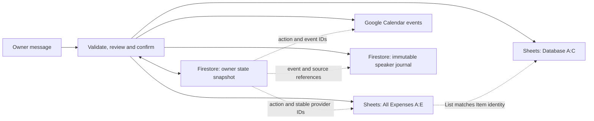

# Database and field guide

The assistant uses Google Sheets for expenses and item/category mappings, Google
Calendar for events, and Firestore for workflow state and original messages.
There is no separate relational database in the production composition. SQLite
is used by local mock/restart harnesses.

The setup-facing Sheet contract below comes from the
[configured target](../src/line_assistant/pilot_config.py) and
[Sheets adapter](../src/line_assistant/sheets_api.py). Firestore fields describe
the implementation at source
[`4ef9481`](https://github.com/thanaphatt1/line-personal-assistant/tree/4ef9481c314229726ae2d950b03d53548b311c60/src/line_assistant).
They are **internal versioned state, not a public editing/import API**. The app
creates them; do not initialize them by copying examples or editing them in a
console. All example names and values here are synthetic.



The dotted name relationship is an application lookup, not a database foreign
key. A category mapping can affect both old and future queries of the same item
identity without rewriting each expense.

## Minimum setup and generated data

| Prepare or review yourself | Generated by the app/provider |
| --- | --- |
| A workbook containing the exact tabs and headers below; distinct numeric tab IDs; reviewed grid bounds and writable cells | New expense values after owner confirmation, plus stable transaction IDs |
| Existing item/category/subcategory rows and the categories you intend to offer | Drafts, review versions/nonces, source references and mapping proposals |
| A configured secondary Calendar and reviewed account/resource access | Event IDs, provider ETags and action markers |
| The configured Firestore database and resource access | Owner state document, leases, receipts, action/model accounting and message documents |

Configuration binds the workbook, numeric tab IDs, owner and calendar outside the
model. See [configuration](configuration.md). `PILOT_SHEET_SCHEMA_VERIFIED=true`
records an operator review; it does not create tabs, hide a column, add headers,
change protections or validate an arbitrary workbook automatically.

## Google Sheets: `All Expenses`

Row 1 must use these exact case-sensitive strings and positions. Data starts in
row 2. The production target uses A–D as inputs and **hidden E** as metadata.

| Column/header | Cell type and meaning | Required? | Producer and validation |
| --- | --- | --- | --- |
| A `Date` | Number: integer Sheets date serial, displayed as a date if the cell is formatted that way | Required for every expense | App encodes the chosen Bangkok calendar date. Date-only values have no fractional time part. |
| B `List` | Text: stored item name | Required; nonblank, up to 200 characters | Owner facts, validated by the app. New normal writes use a resolved catalog name; legacy unmapped names can remain for review. |
| C `Cost` | Number: positive finite THB amount with at most two decimal places | Required | Owner facts; model/tool boundary uses a Decimal string. New proposals also obey the bounded [money contract](../src/line_assistant/contracts.py). No currency symbols in this numeric cell. |
| D `Remark` | Text, up to 500 characters | Header required; value may be empty (`""`) | Owner note or app default empty string. Saved expense edits preserve it. |
| E `transaction_id` | Text: stable identity of this saved expense | Required for new app writes and saved-record editing; may be blank on legacy rows | App generates a SHA-256 hex string from the durable action key and zero-based entry index. Must be unique and remain hidden/unchanged. |

A schematic row, shown as underlying cell values:

| Date | List | Cost | Remark | transaction_id |
| ---: | --- | ---: | --- | --- |
| 46311 | Rail ticket | 35 | commute | `<app-generated-id>` |

`46311` is `2026-10-16` under the
[date codec](../src/line_assistant/sheet_dates.py), whose epoch is `1899-12-30`.
The placeholder ID is not a value to paste into a workbook. A transaction ID is
not the row number: the app can locate a moved row by its unchanged ID before
performing a new review/check. Duplicate or changed IDs fail validation.
Existing IDs accepted by saved-record lookup use 1–128 letters, digits, `_` or
`-`; newly generated IDs use 64 hex characters.

Legacy rows without an ID can participate in complete expense reads and
historical category review. They are not silently assigned an ID or eligible
for a saved-expense edit. The current saved-edit workflow changes only date,
item or amount; it does not change Remark, IDs, categories or formulas. See
[the editor](../src/line_assistant/expense_edits.py) and [feature limits](saved-record-edits.md).

## Google Sheets: `Database`

This tab is the item catalog. It is not the Firestore database. Required row-1
headers are exactly `Item`, `Categories`, `Sub-categories` in A–C.

| Column/header | Type and role | Required? | Producer and validation |
| --- | --- | --- | --- |
| A `Item` | Text: canonical stored item name | Nonblank for a catalog row; up to 200 characters | Reviewed setup or a separately confirmed new-item/mapping append. Duplicate normalized names are rejected. Empty rows are ignored; do not use an empty Item as a taxonomy-definition row. |
| B `Categories` | Text: category label | String; blank legacy values are accepted but count as unassigned | Reviewed existing category, or app append of a confirmed existing pair. A blank label is not a confirmed category. |
| C `Sub-categories` | Text: subcategory within that category | String; may be empty if that is an existing pair | Existing category/subcategory pair. Both label fields are bounded to 200 characters. |

Synthetic examples:

| Item | Categories | Sub-categories |
| --- | --- | --- |
| Rail ticket | Transportation | Rail |
| Apple snack | Food | Snacks |
| Other transport | Transportation | |

The app derives available category/subcategory pairs from these rows; there is
no separately required category table or ID column in this tab. An empty
subcategory is a real existing pair when attached to a nonblank category. New
item enrollment and mapping proposals select an existing pair; they do not
invent a taxonomy or create aliases. Existing blank-category rows need explicit
resolution; the append workflow cannot overwrite them.

Identity lookup normalizes Unicode NFC, outer whitespace and case. Internal
spaces remain significant; unique spacing matches can resolve, while collisions
need a choice. Fuzzy suggestions do not establish the identity of a saved row.
See [catalog rules](../src/line_assistant/catalog.py) and
[taxonomy construction](../src/line_assistant/taxonomy.py). Production taxonomy
reads A–C; no alias or fourth mapping column is required.

Permanent mapping appends only confirmed names to A–C. It affects classification
of the same stored identity across old/future queries. A one-time provisional
summary creates no permanent Database mapping. Neither workflow rewrites the
original expense rows. See [provisional categories](provisional-categories.md)
and [historical category review](historical-categories.md).

## Grid, formulas, dates and direct edits

- The numeric tab IDs must match the configured titles. Production config bounds
  the complete grid/ID scan with `PILOT_SHEETS_MAX_ROWS` (2–1001); a ten-name review
  page does not limit that source read. Reads outside the bound fail rather than
  return a partial result as complete.
- Plain catalog reads need at least A–C. Current enrollment/permanent-mapping
  writes additionally require a reviewed **26-column A–Z Database grid** and
  append capacity. This is an adapter condition, not a requirement to fill 26
  business columns.
- No spreadsheet formula is required for the app's own category lookup or
  totals. A–D are literal expense inputs; saved-record and historical reads
  reject input formulas. Do not replace the stable ID with a row-based formula.
  Existing extra report/formula columns are outside the write contract; the app
  does not create, repair or overwrite them. Occupied cells/formulas can affect
  server append position and capacity, which the app checks across the grid.
- The app does not intentionally extend the configured grid or change formats,
  headers, validation or protections. Enforced protections need an explicit
  reviewed access policy; permission cannot be inferred from a successful read.
- Business dates and relative words use **Asia/Bangkok**. The codec encodes the
  selected calendar date as an integer, not a UTC instant. It does not change
  the workbook timezone; formatting and that setting need their own review.
- Manual data corrections while the bot is idle are external edits. Preserve
  the schema, complete rows and stable IDs. They can invalidate an existing
  review because the app compares current data/catalog fingerprints before
  confirming. Do not sort/insert/edit rows concurrently with a bot operation.
  The owner lease does not lock a human or another API writer. Sheets offers no
  conditional compare-and-swap between the final read and write; readback cannot
  eliminate every outside-writer race. Wait for a terminal result or uncertain
  outcome reconciliation before another writer proceeds.

## Firestore: owner state document

The production composition stores one core document at:

```text
assistant_pilot_states/{owner_hash}
```

`owner_hash` is SHA-256 of the configured owner string. It is app-generated; a
hash is not encryption or a substitute for access control. The generic base
adapter also supports other collection names, but the history factory selects
the one above. [Production composition](../src/line_assistant/production_history_state.py)
and [the Firestore adapter](../src/line_assistant/firestore_state.py) own this contract.

| Stored field | Firestore type | Required/default | Purpose and producer |
| --- | --- | --- | --- |
| `owner_hash` | String | Required on every app-created document | App binds the document to the configured owner. |
| `snapshot` | String | Required | App serializes core and history state as JSON, with a bounded lossless compression envelope when needed. This is not a map of editable top-level Firestore draft fields. |
| `lease_owner` | String | Required; empty string when released | App-generated worker holder token, not the LINE owner ID. |
| `fence` | Integer | Required; starts at 1 | App increments it when acquiring a new lease. Stale workers cannot commit newer state. |
| `lease_until` | Timestamp | Required | App's lease deadline; an empty holder means no active holder. It is not a document-deletion TTL. |
| `commit_nonce` | String | Required; fresh per commit | App-generated token used with exact field comparison to resolve an uncertain state-commit acknowledgement. |

Firestore supplies document `name` and `updateTime` as response metadata, not
business fields. The adapter uses `updateTime` (or `exists=false` for creation)
as a conditional commit precondition. It renews/checks the lease immediately
before provider effects. That fences state commits; it cannot stop a Sheets
request already in flight or protect against external writers.

The [snapshot codec](../src/line_assistant/snapshot_codec.py) accepts versioned
JSON/compression formats within explicit encoded/expanded size limits. Oversize
or invalid snapshots stop processing instead of truncating action/history proofs.
Compression does not encrypt the contents.

## Inside the snapshot: implementation-specific fields

The following are logical JSON shapes **inside `snapshot`**, not separate
Firestore collections. Empty maps/nulls are normal for a new state. Older
supported formats can omit some fields and restore documented code defaults;
hand-written partial snapshots are not a supported setup method.

| Field/group | Shape and required/conditional behavior | Meaning |
| --- | --- | --- |
| `version`, `owner_id` | Required integer `1` and owner string in the core format | Version and exact restore binding; the owner string is private data. |
| `workbook_id`, `workspaces`, `event_workbooks` | Selected workbook string/null, map of retained workspace snapshots, map from event ID to workbook; maps initially empty | Prevent a prior event from moving to a newly selected workbook. Only configured current/legacy workbooks are eligible. |
| `pending` | Null or `{kind, token, origin_event_id, source_timestamp, expires_at, payload}` | One domain review/selection at a time; `source_timestamp` is webhook milliseconds, `expires_at` is an aware ISO timestamp. Payload shape depends on the review kind. |
| `last`, `recent_turns` | Null or `{kind, refs, expires_at}`; a bounded list | Verified last-action/follow-up context, not authorization for a new write. |
| `claims[event_id]` | `{fingerprint, expires_at, action_key}`; `action_key` may be null | Bind an ingress event to its payload and, when confirmed, a durable action. Changed redelivery payloads are rejected. |
| `receipts[event_id]` | `{fingerprint, result, expires_at}`; result is `{status, message, data}` | Return the verified result on duplicate delivery without repeating effects. |
| `actions[action_key]` | `{kind, payload, metadata, deadline, expires_at, status, result}`; result initially null | Record a confirmed operation before I/O. Status moves through `prepared`, `executing`, possibly `uncertain`, and `completed`. Payload/metadata bind target, source/review proofs and request fingerprints. |
| `replies[event_id]` | `{content_hash, expires_at, status, ...}` | Record delivery of the exact rendered reply. Optional fields include token deadline, HTTP status/error category and attempt timing; no credential or reply-token value is required here. |
| `model_runs[phase_key]` | `{fingerprint, month, reserved_micro_usd, expires_at, status, decision}`; decision initially null | App tracks one model phase/reservation and any validated recorded decision. Uncertain calls must not be silently retried. |
| `model_budgets[month]`, `model_halted` | Budget records; boolean defaults false | Budget record has `reserved_micro_usd`, `calls`, `day_calls`, `last_reserved_at` (initially 0, 0, empty map, null). Costs use integer micro-USD. Counting is distinct from optional enforcement and from provider invoices. |
| `production_ready` | Boolean, default false on compatible restore | Internal readiness state; do not set it manually to bypass startup. |
| `canary` | Null by default or a retained compatibility allowance/proof | Conditional legacy controlled-canary state; ordinary startup/tests do not create a real business canary. Do not reset a consumed allowance. |
| `history24` | `{active_workbook, current, workspaces}` when the history composition has checkpointed | History extension with active/retained workbook parts described below. Core and history workbook bindings must agree. |

See [state records](../src/line_assistant/state.py) and
[serialization/restore](../src/line_assistant/persistence.py) for the precise types.
IDs such as `event_id`, `action_key`, `draft_ref`, `entry_ref` and `source_ref`
have distinct roles. An action key can derive the stable Sheets transaction ID
or Calendar creation ID; an entry/source reference cannot authorize an effect.

### History, drafts and review proofs

`history24.current` and retained workspace parts use `local-history-state-v1`.
The name is a persisted format identifier also used by the production composition;
it does not mean production uses local SQLite.

| History-part fields | Required/conditional and purpose |
| --- | --- |
| `format`, `owner_id`, `history_bytes`, `history_removed` | Version/owner and bounded-history accounting, generated by the serializer. |
| `history` | Speaker/tool history list in the compatible inline format. When the separate raw journal is active/migrated, persisted `history` is empty and originals remain in that journal. |
| `drafts`, `draft_proofs` | Expense draft maps keyed by `draft_ref`; empty initially. Proof keys must match draft keys and validate owner/version/fingerprint. |
| `calendar_v1` | Conditional `{format, drafts, proofs}` envelope. Format `calendar-history-v1` retains timed compatibility; `calendar-history-v2` supports the all-day field. |
| `calendar_batches_v1` | Conditional `{format, batches, proofs}` with `calendar-batches-v1`; connects grouped drafts and preserves partial/uncertain member outcomes. |
| `raw_history` | Conditional `{enabled: true, rolling_summary}`; summary null until a validated summary is available. |

An expense draft carries app-generated `draft_ref`, `owner_id`, positive
`version`, `status`, `created_at`, `updated_at`, `expires_at`, `catalog_hash`,
`entries` and `review`. Each entry has `entry_ref`, `item`, `amount`, `date`,
`note`, `kind`, `mapping`, `source_refs`, `date_parts`, `date_basis` and
`date_issue`. Partial values can be null until clarified; note defaults empty
and kind is `expense` in this workflow. `fact_sources` and optional
`amount_occurrence` bind fields/price occurrences to original owner text. A
review is null until ready, then binds a nonce, payload/catalog hashes and time.
An edit creates a new version and invalidates old consent. All these fields are
generated/validated by the app, not columns to add to a Sheet.

Calendar drafts additionally bind `calendar_id`, literal `facts`, field sources
and time anchors, normalized `start`/`end`, `missing_fields`, `issues`, optional
`all_day`, and a review with conflict/payload proofs. A batch binds its member
drafts and their current versions. Original owner wording is evidence; a model
cannot replace the current proof, nonce or delivered-review requirement.
See [history restore](../src/line_assistant/history_persistence.py),
[Calendar restore](../src/line_assistant/calendar_workflow.py) and
[batch restore](../src/line_assistant/calendar_batches.py).

Saved-record selection/review, provisional labels and historical category pages
use typed `pending.kind` payloads and `Action` metadata rather than additional
top-level collections. They carry owner/workbook/target bindings, candidate or
group references, source/catalog/record fingerprints, review version/hash/nonce
and a seal. Historical pages also retain scope, pagination and included-name
selection. These are workflow internals; their integrity does not grant consent
or permit manual edits. See [saved edits](../src/line_assistant/saved_edits.py),
[provisional categories](../src/line_assistant/provisional_categories.py) and
[historical categories](../src/line_assistant/historical_categories.py).

## Firestore: separate original-message journal

The leaf document path is:

```text
assistant_raw_history/{owner_digest}/workbooks/{workbook_digest}/assistant_raw_messages/{message_key}
```

These IDs use the app's canonical JSON digest: `digest([owner])`,
`digest([workbook])` and `digest([event_id, role])`. This owner digest is not the
same construction as the core `owner_hash`. Parent path segments provide a
namespace; they do not imply extra catalog/owner metadata records. See
[the journal](../src/line_assistant/raw_history.py).

| Stored field | Firestore type | Required? | Purpose/producer |
| --- | --- | --- | --- |
| `at` | Timestamp | Required | App uses the original aware speaker timestamp; Firestore may normalize its RFC3339 representation. |
| `payload` | String containing JSON | Required | Immutable original speaker record, serialized in a canonical order. |
| `auth_mac` | String | Required | App-generated HMAC binding payload to its owner/workbook path using an existing secret. The secret itself is not stored in the document. This authenticates data; it does not encrypt message text. |

The payload has `role` (`user` or `assistant`), nonempty `event`, aware ISO `at`
and string `text`. User records require the app-derived `source_ref` from that
event. App-added `sequence` preserves speaker ordering; delivered assistant
records include `delivery_verified` and `content_hash`. Tool records are not
speaker journal messages. Assistant publication is tied to verified reply
delivery, not merely a generated response.

Writes are create-only and keyed by event/role. Duplicate or uncertain journal
acknowledgements must match the exact immutable record, timestamp and MAC.
Original text is private even when IDs are hashed.

`rolling_summary` is a derived cache with format `raw-summary-provenance-v2`.
It contains `summary`, `source_refs`, `source_dates`, `covered_ids`,
`covered_records`, `verbatim_ids`, `covered_from`, `covered_until` and
`expires_at`. The model proposes summary text/citations; the app verifies source
identity, coverage and expiry. It cannot replace originals or consent records.

## Calendar records and other storage

Confirmed Calendar creations live in Google Calendar, not as a separate
Firestore events collection. The adapter creates a stable hashed `id`, owner
title as `summary`, and `start`/`end`: aware `dateTime` values with
`Asia/Bangkok` for timed events, or `date` strings for all-day events. All-day
ends are exclusive; a one-day event ends on the next date. Google supplies the
ETag used for conditional rescheduling. App-created events also have private
`line_action` and `line_payload` hashes in `extendedProperties` for positive
reconciliation. Reminders are disabled in the current creation adapter.
See [Calendar provider](../src/line_assistant/calendar_provider.py) and
[saved-record limits](saved-record-edits.md); these markers are not extra fields
the owner must create on existing events.

Local SQLite snapshot/provider/journal tables exist only for mock and recovery
harnesses; they are not a production database to deploy. Cloud Storage holds
reviewed build source archives, Artifact Registry holds images, and Cloud Logging
holds operational logs. They are separate from the application's expense,
Calendar and workflow-state schemas.

## Expiry, deletion and recovery

Durable deadlines are app-generated aware timestamps. Firestore stores native
timestamps in the envelope/journal, while the snapshot uses ISO strings. LINE
source timestamps are integer milliseconds. Business date-only values and
relative date interpretation follow Bangkok dates rather than a UTC day reset.

The **24-hour window is a model-context selection rule, not a deletion policy**.
The journal is paginated and retains originals; this code does not install a
Firestore TTL policy, automatically delete old message documents or declare a
retention period. Lease expiry releases eligibility for another worker; it does
not erase the state document.

Application expiry can discard expired pending reviews, old ordinary receipts
and derived caches. Executing/uncertain actions, unresolved model records and
protected partial Calendar outcomes remain recoverable even when a normal TTL
has elapsed. Model reservation accounting and consumed canary allowances are not
reset to make space. No midnight reset or context compaction is permission to
delete originals or clear an uncertainty ledger.

Recovery changes traffic to a compatible runtime and preserves newer state/raw
history. It does not restore an old snapshot over current data or undo a saved
expense, mapping or event. Data deletion/retention changes need a separate design
covering receipts, references, recovery and access; none are performed by this
documentation. See [deployment](deployment.md) and [security](../SECURITY.md).
