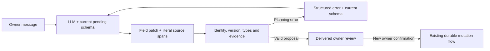

# Schema-driven conversation updates

The planner completes or corrects pending expense, Calendar and generic-table
records through `patch_pending_records`. This tool prepares a proposal. A new
owner confirmation of its delivered review is still required for any provider
mutation.

`pending_records` exposes current draft versions, stable record references,
display ordinals, retained values, editable fields and declared enum choices.
The adapter derives ordinary table fields from the registered table metadata;
it does not assume that a record contains a date or monetary amount. Disabled
capabilities are omitted. Storage identifiers and credentials are excluded.

Each changed field supplies `field`, `value`, `source_text` and `source_ref`.
Evidence must be a literal span in a verified visible owner message. The current
request supplies intent and selects the facts; cited owner history may supply
their values. The original source timestamp anchors relative dates, even when
the current request arrives on a later day. Assistant replies, summaries,
expired sources and cancelled expense evidence cannot supply new field facts.
Omitted fields
and records retain their certified facts. Names and text remain literal;
amounts and dates keep the existing domain evidence checks. A declared choice
can be a semantic model proposal, so a synonym need not repeat a canonical
enum label. Such an interpretation is reviewable, not proof of owner consent.
The owner must inspect the proposed values before confirming them.

In the raw-history model workflow, the planner interprets requests, questions,
conditional requests, hypothetical examples and negations. Keyword intent
guards do not veto preparation; a tool call still cannot confirm a write.
Calendar/expense requests reach the same planner, including reads that join
appointments to spending dates, without a pre-model domain keyword router.
Legacy workflows without raw-history planning retain their original parsers.

The expense adapter stages all row changes before publishing the resulting
draft. An invalid sibling change cannot leave a partial rename or category
update. Selecting a category for an unknown name already prepares its
enrollment. Its metadata marks a redundant new-name action as implied by that
category; normalization removes the redundant action, never adds facts or
permissions. Multiple category/subcategory choices remain constrained by the
actual catalog pairs.

Current `prepare_expenses` calls give the model responsibility for grouping
and field ownership. The strict schema contains `groups`, individual `entries`,
`counts` and `context_numbers`. A quotation contains the original owner
`source_ref`, exact `text` and its zero-based `occurrence`. The server derives
coordinates without asking the model to count Unicode offsets.

Each group provides the full original item quotation and its source portions;
interleaved groups can select separate portions of one message. Groups must be disjoint;
their item and amount proofs must lie inside them. An entry selects a group,
one literal numeric amount, a date quotation or offered date ref, and an
optional literal note. Shared dates may lie outside groups. Source quotations
remain immutable; proposed catalog spellings never replace the owner's words.

An entry can supply `date_value` as an interpreted ISO date together with its
original `date_source` quotation. The server uses the existing temporal
components validator in that same preparation call and retains its proof,
original timestamp and quoted wording. This avoids a separate temporal tool
round trip for clear dates. An offered `date_ref` is an alternative, never a
second date source. Invalid calendar dates, future expense dates and invented
quotations remain rejected. The interpretation is still a model proposal for
owner review; an exact quotation does not establish that its meaning is right.

For a requested additional payment, `reuse_previous_amount=true` selects the
existing verified saved-amount lookup rather than supplying an unquoted
number. It can use an unambiguous amount saved on the same proposed day. This
is still a new reviewed payment, not a saved-record update or confirmation.
See [previous expense amounts](previous-expense-prices.md) for source checks,
ambiguous history and proof compatibility.

When a quoted date remains genuinely ambiguous after considering the dialogue,
`date_ambiguous=true` with null `date_value`/`date_ref` retains the other facts
and asks for the date directly. Missing owner meaning is not a malformed tool
argument that needs another planning attempt. Internal compatible calls that
omit these fields retain their previous date resolution path.

The server checks quotation existence, numeric values, field overlap and
numeric coverage across the whole current message and selected historical
portions. A duplicated numeric span needs an explicit per-payment occurrence
count covering exactly those entries; a batch count cannot authorize reuse.
Distinct equal amounts keep distinct source occurrences. Numeric non-payment
context requires an explicit explanation displayed in the bound review.
Missing evidence returns field diagnostics to the existing repair loop.
The code does not rediscover groups from punctuation, Thai conjunctions,
name/amount adjacency or a fixed sentence grammar. It does not expand counts
into rows: the model proposes every occurrence. Interpreting a total versus a
per-payment amount remains a semantic model responsibility, checked by the
owner's complete review. Literal provenance is not proof of semantic intent.

Pending field patches also use their already-validated source spans directly
instead of regrouping the entire message. Existing catalog, numeric/date,
identity, version and final-confirmation checks remain. A delivered previous
amount offer is an explicit `previous_price_ref` choice in the pending schema;
it still needs its original offer checks and a new owner review.

A correction can apply a shared date to several pending rows while changing
one row's amount. The ordinal in `แก้รายการ 2` identifies a row; it cannot become
money evidence. All changed fields are validated and staged together, and
untouched fields retain their original provenance.

Catalog drift is revalidated during expense patch staging and fresh-review
preparation. An unrelated name addition does not block completing an older
pending record. The server rechecks every sibling's current identity and
category pair while retaining names, amounts, dates, notes and original evidence.
Removed names or category choices require resolution; a newly existing name no
longer proposes duplicate enrollment. A replacement review gets a new version
and nonce. Confirmation still checks the entire current catalog hash, so a
further edit after that review invalidates its consent. Read-only views may
describe refreshed choices without publishing a replacement draft or consent.

With pending records present, creation tools expose null draft/batch references
in the model schema; updates use the shared patch tool. Existing domain
handlers remain available internally for compatible calls and their validation
rules. The earlier sentence-based rename/category continuation shortcut is
removed from routing. Dedicated saved-record editing, cancellation and
confirmation retain their own contracts.

Recoverable argument errors return the current schema and permitted tools to
the same planner using tool-declared recovery metadata. A repair can change
preparation arguments, not authorize an external write. Repeated normalized
diagnostics or plans stop repair; there is no fixed two-attempt limit. Unknown
provider faults are not automatically retried. Existing multi-source read
analysis retains its own evidence/goal-preserving continuation. Failed patches
retain verified focus and table drafts; free model text cannot report an
unverified successful change.

When response realization is enabled, recoverable preparation feedback can
also offer `final_reply`: current checked facts and a request-local
`response_ref`. The repair planner may call `finish_preparation_reply` with a
document using the existing reply schema instead of starting another composer
request. The same fact renderer checks it; draft version, result status,
controls and confirmation requirements are preserved. A successful repair
revokes the old reply context. Invalid free text or an unavailable repair
response uses the checked core explanation without another model call. This
exit cannot save, authorize, or turn a failed operation into success, and is
not offered inside read-analysis or pending Calendar semantic selection.

Omitted payment siblings and invalid field evidence also return to the planner.
When a new proposal retains verified facts after rejecting a field, a corrected
creation may replace only that same turn's undelivered partial proposal. This
repair cannot replace earlier pending work, reuse a delivered review or obtain
write consent. An unsuccessful repair retains verified facts for clarification.
Failed preparation receipts retain verified owner source references for
continuation. The current model selects relevant earlier visible quotations;
the new path does not require a keyword match against the latest item. Reusing
recorded facts never reuses consent, and overlapping pending work still needs
its owned patch tool. Legacy internal calls and historical receipt helpers
retain their prior source/grouping checks. They are not an alternative schema
offered to the current model. No stored history is rewritten.

Date/time changes may cite a verified `temporal_ref` instead of copying a
normalized value from the owner text. The original span remains evidence;
the server validates the resolution and its basis. See
[temporal plans and recovery](temporal-plans.md) for supported operations.

This uses the standard [OpenAI function-calling loop](https://developers.openai.com/api/docs/guides/function-calling):
application tool results, including structured errors, are returned to the
model. No new model, credential, provider access or collection is required.

This is a common pending-record interface, not arbitrary SQL or unrestricted
execution. New scalar tables on the supported stores use metadata and a bound
adapter. New providers or new operations still require implementation. Semantic
interpretation can be wrong, so confirmation, source/version checks and varied
synthetic conversation tests remain necessary.
