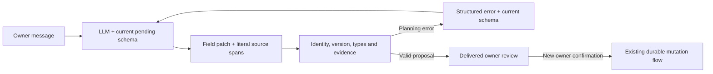

# Schema-driven conversation updates

The planner completes or corrects pending expense, Calendar and generic-table
records through `patch_pending_records`. This tool prepares a proposal. A new
owner confirmation of its delivered review is still required for any provider
mutation.

`pending_records` exposes current draft versions, stable record references,
display ordinals, retained values, editable fields and declared enum choices.
The adapter derives ordinary table fields from the registered table metadata;
it does not assume that a record contains a date or monetary amount. Disabled
capabilities are omitted. Storage identifiers and credentials are excluded.

Each changed field supplies `field`, `value`, `source_text` and `source_ref`.
Evidence must be a literal span in a verified visible owner message. The current
request supplies intent and selects the facts; cited owner history may supply
their values. The original source timestamp anchors relative dates, even when
the current request arrives on a later day. Assistant replies, summaries,
expired sources and cancelled expense evidence cannot supply new field facts.
Omitted fields
and records retain their certified facts. Names and text remain literal;
amounts and dates keep the existing domain evidence checks. A declared choice
can be a semantic model proposal, so a synonym need not repeat a canonical
enum label. Such an interpretation is reviewable, not proof of owner consent.
The owner must inspect the proposed values before confirming them.

In the raw-history model workflow, the planner interprets requests, questions,
conditional requests, hypothetical examples and negations. Keyword intent
guards do not veto preparation; a tool call still cannot confirm a write.
Calendar/expense requests reach the same planner, including reads that join
appointments to spending dates, without a pre-model domain keyword router.
Legacy workflows without raw-history planning retain their original parsers.

The expense adapter stages all row changes before publishing the resulting
draft. An invalid sibling change cannot leave a partial rename or category
update. Selecting a category for an unknown name already prepares its
enrollment. Its metadata marks a redundant new-name action as implied by that
category; normalization removes the redundant action, never adds facts or
permissions. Multiple category/subcategory choices remain constrained by the
actual catalog pairs.

With pending records present, creation tools expose null draft/batch references
in the model schema; updates use the shared patch tool. Existing domain
handlers remain available internally for compatible calls and their validation
rules. The earlier sentence-based rename/category continuation shortcut is
removed from routing. Dedicated saved-record editing, cancellation and
confirmation retain their own contracts.

Recoverable argument errors return the current schema and permitted tools to
the same planner using tool-declared recovery metadata. A repair can change
preparation arguments, not authorize an external write. Repeated normalized
diagnostics or plans stop repair; there is no fixed two-attempt limit. Unknown
provider faults are not automatically retried. Existing multi-source read
analysis retains its own evidence/goal-preserving continuation. Failed patches
retain verified focus and table drafts; free model text cannot report an
unverified successful change.

Date/time changes may cite a verified `temporal_ref` instead of copying a
normalized value from the owner text. The original span remains evidence;
the server validates the resolution and its basis. See
[temporal plans and recovery](temporal-plans.md) for supported operations.

This uses the standard [OpenAI function-calling loop](https://developers.openai.com/api/docs/guides/function-calling):
application tool results, including structured errors, are returned to the
model. No new model, credential, provider access or collection is required.

This is a common pending-record interface, not arbitrary SQL or unrestricted
execution. New scalar tables on the supported stores use metadata and a bound
adapter. New providers or new operations still require implementation. Semantic
interpretation can be wrong, so confirmation, source/version checks and varied
synthetic conversation tests remain necessary.
