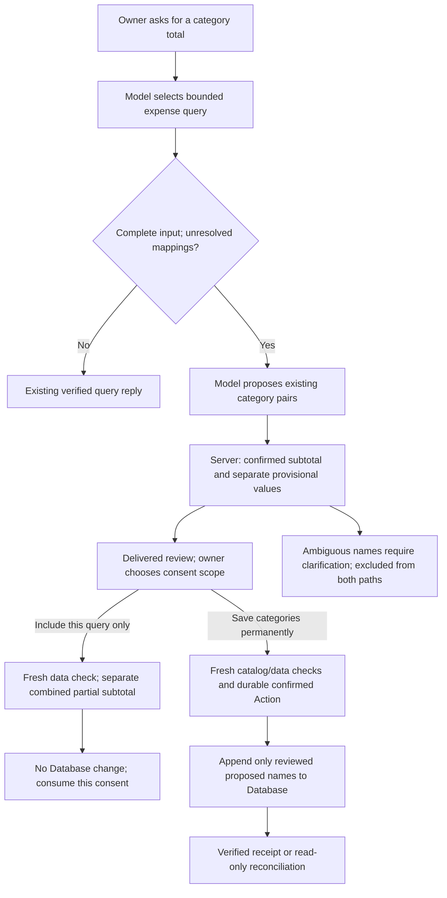

# Provisional categories for unresolved expenses

This optional feature is disabled by default. A complete expense read that
cannot resolve category membership can offer bounded category suggestions.
It keeps three states distinct:

| State | Authority | Treatment in a category total |
| --- | --- | --- |
| Confirmed | Existing Database identity and mapping | Confirmed partial subtotal |
| Proposed | Model suggestion using an existing category/subcategory pair | Separate provisional amount, count and names |
| Ambiguous | Meaning or existing-name identity needs clarification | Excluded; candidates may be shown |

Missing mapping alone does not imply unclear meaning. A literal name can support
a tentative category suggestion without an established Database identity. The
model may suggest at most ten unresolved names from the current or latest
delivered query, using existing category pairs. It cannot invent names, new
categories, aliases or confidence percentages. Fuzzy name matches and ambiguous
spacing identities remain ambiguous rather than becoming authoritative matches.
Blank categories on existing items also require separate owner resolution.

The server calculates all amounts from the verified read. Proposed values never
silently enter the confirmed subtotal. The preview lists proposed/ambiguous
names, amounts and counts, and discloses omitted names. Schema/provider failures
or incomplete input cannot produce proposals or fabricated zero totals.

After checking the latest delivered review, the owner can say
**“รวมข้อเสนอครั้งนี้”** to include only the proposed entries matching that query's
filter. The reply keeps the Database subtotal and the consented provisional
subtotal separate, shows the included names and labels their combination as
partial and provisional. This consent is consumed and never persists a mapping.
To save later, the owner must request and receive a fresh review, then confirm
the permanent scope separately.

**“บันทึกหมวดถาวร”** is a different confirmation. With the separate mapping flag
enabled, it adds only the displayed proposed names and their existing category
pairs. Ambiguous names are excluded. It does not edit expense rows, amounts,
dates, transaction IDs, formulas, existing Database rows or categories. The new
mapping becomes confirmed input only when a subsequent read observes it in
Database. No operator has classified or changed real owner records as part of
development testing.

Both controls require a new signed owner message after the latest delivered
unchanged review. Owner/workbook/query scope, nonce, review hash, original source
provenance and expiry are bound on the server. Full reference/nonce text controls
are also supported. Bare “ยืนยัน” asks which consent scope rather than choosing
one. Changes in the catalog or queried data require a fresh read/review.
Replay returns the saved receipt. A lost acknowledgement is reconciled by reading
the exact desired mappings; an old-looking catalog never authorizes a retry.
Other unresolved actions block an additional mapping write.

Permanent mapping uses the existing Sheets scope and a single bounded
`appendCells` request for Database A:C. Capacity/protection checks fail closed.
As with saved expense edits, Sheets provides no conditional compare-and-swap
against outside collaborators. Consequently permanent mapping additionally
requires an explicitly reviewed policy controlling other Database writers and
structural edits. The process lease does not enforce that policy externally.
Positive reconciliation can establish current mapping values, not unique
attribution to this write. No new access or credentials are configured.

Flags are `PILOT_PROVISIONAL_CATEGORIES_ENABLED=false` and
`PILOT_PROVISIONAL_MAPPING_ENABLED=false`. Mapping enablement also requires
`PILOT_SAVED_EXPENSE_EDIT_CONCURRENCY=reviewed_single_writer` and existing
history/state configuration. Enabling suggestions alone allows query-only
consent without Database writes. Model interpretation stays within the existing
two-call turn budget; tools never supply confirmation.

Rollback uses the same compatible image with all new mutation/proposal flags
OFF. It preserves pending reviews, query-only receipts, uncertain actions and raw
history, and can reconcile old mapping attempts by reads. Keep ordinary Calendar
access available when the image also contains saved Calendar actions. A prior
image that merely roundtrips generic state is not an executable recovery path
for new action types. Traffic rollback cannot undo a mapping or record change;
never restore older snapshots over newer data.

Development uses synthetic names and integrations. The predefined cases include
possible mistaken aliases, ambiguous categories, stale catalogs, one-time versus
permanent consent, repeated confirmations and partial-data honesty. Failed runs
remain counted. Model category suggestions still need human review; these checks
do not establish general classification accuracy or live permission/rollback
validation. Source publication does not enable or deploy this feature.

See the [development scorecard and retained failures](../benchmarks/provisional-categories-v2/README.md).
