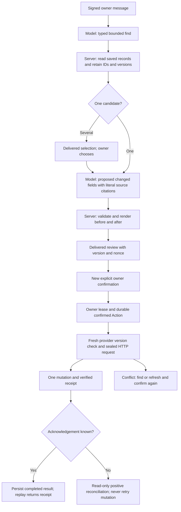

# Saved expense corrections and Calendar rescheduling

This development feature is disabled by default. It adds proposals for changing
one saved expense's item, amount or date, and for moving one saved appointment.
A new owner confirmation of a delivered before/after review is required for
each change. Publishing source does not enable the feature or deploy it.

The model interprets the request and calls typed find/propose tools. The server
keeps stable provider IDs and versions, returns opaque candidate references,
checks literal owner sources and renders the authoritative review. Several
matches require an owner choice. Legacy expense rows without an existing
`transaction_id` cannot be edited; the feature never assigns IDs to old rows.
Unknown catalog names require clarification rather than a new mapping.

An expense edit locates its row again by transaction ID, compares the frozen
input fingerprint and catalog, and changes only the necessary A/B/C
`userEnteredValue` cells in a single batch. It preserves Remark, transaction ID,
cell formatting and other columns. Formula-valued input cells, duplicate IDs,
schema drift and unreviewed protections fail closed. Returned row identity and
a fresh readback must agree before reporting an acknowledged success.

**Sheets concurrency limitation:** the documented batch API provides atomic
batch application, but does not expose a Calendar-style conditional ETag write.
The absence of compare-and-swap is an inference from its documented request
contract. An outside collaborator can change values or insert rows between the
fresh read and the write. Detection after writing cannot undo that race.
Consequently expense editing additionally requires the explicitly reviewed
`reviewed_single_writer` policy. Enable it only when other writers and structural
edits are controlled; this code cannot enforce that policy for collaborators.
[Sheets batch contract](https://developers.google.com/workspace/sheets/api/reference/rest/v4/spreadsheets/batchUpdate)

Calendar changes use the saved event ID and ETag, a conditional `PATCH` with
`If-Match`, and `sendUpdates=none`. A 412 conflict requires a fresh review, with
no automatic rebase or retry. Only start/end and merged private action markers
are patched. Title, timed/all-day mode, duration unless explicitly changed,
reminders, shared properties and other fields are preserved. Guest, recurring,
conference and special event types are excluded. All-day end dates are
exclusive internally and shown inclusively to the owner. Existing
`calendar.events` access is used; no new scopes or access setup are added.
[Conditional resource updates](https://developers.google.com/workspace/calendar/api/guides/version-resources),
[PATCH contract](https://developers.google.com/workspace/calendar/api/v3/reference/events/patch).

The model cannot confirm, delete or cancel saved records. Confirmation is bound
to the owner, workbook, Calendar, selected stable ID, review version, nonce,
payload and latest delivered receipt. Expired, undelivered, changed or foreign
reviews cannot write. Failed attempts remain durable. An old-looking value
after a timeout does not prove a write cannot arrive later; the action remains
uncertain and blocks additional writes. Calendar reconciliation requires the
action marker and desired state. Sheets can only establish that the current
record matches the confirmed values, so that result is worded as an observation.

Configuration flags are `PILOT_SAVED_EXPENSE_EDITS_ENABLED=false`,
`PILOT_SAVED_CALENDAR_RESCHEDULE_ENABLED=false`, and
`PILOT_SAVED_EXPENSE_EDIT_CONCURRENCY=off`. Enabling either requires the existing
history/state composition; Calendar rescheduling also requires Calendar enabled.
No generic HTTP method, header, target or credential interface is exposed.

Rollback must use a compatible image that understands these pending records
and Actions. A same-image bridge disables both new mutation flags while keeping
history, state and ordinary Calendar access enabled for read-only reconciliation.
It preserves raw history and current snapshots. It does not restore snapshots
over newer data or undo already applied changes. Prior images may roundtrip
the generic envelope yet lack the new reconciliation behavior; persistence
compatibility alone is not proof of safe executable rollback.

Provider and signed webhook tests use synthetic HTTP services. They cover cold
restoration, replay, stale versions, lost acknowledgements, uncertainty, exact
field preservation, source evidence, ambiguity, disabled flags and nonce/owner
binding. Live owner record edits, live permission checks and traffic rollback
are outside this development validation. Separate source-bound release approval
and an explicit concurrency decision remain necessary.

The [synthetic development results](../benchmarks/saved-record-edits-v1/README.md)
include all failed runs and the final frozen-runtime multi-turn Luna check.
