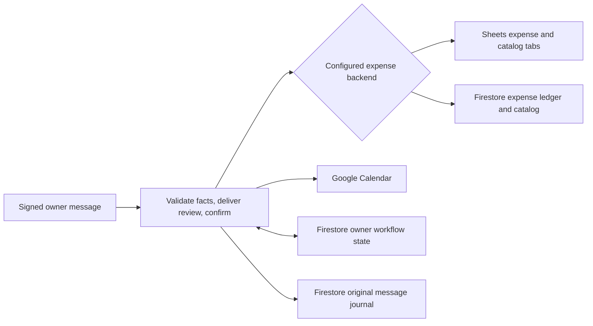

# Expense storage: Sheets default, Firestore alternative

Sheets remains the default. It is convenient for inspecting and maintaining a
personal expense ledger. The history production factory also supports an
explicit Firestore expense/catalog backend. Selecting it does not copy Sheets
data, create a spreadsheet, migrate history, or enable dual writes.



The Firestore business backend uses the same configured project's `(default)`
database as workflow state. Business records live under a separate collection:

```text
assistant_expense_owners/{sha256(owner_id)}/ledgers/{dataset_id}
  expenses/{transaction_id}
  catalog/{sha256(normalized_item)}
  operations/{digest(action_key)}

assistant_pilot_states/{owner_hash}                         # existing workflow
assistant_raw_history/{owner_digest}/workbooks/{scope_digest}/assistant_raw_messages/{key}
```

Hashed owner IDs are namespaces, not encryption or access control. The server
derives every business path from its configured owner/dataset. Tools never
receive project IDs, document paths, row numbers, credentials, or write consent.
Server service-account access is governed by IAM; client Firestore Security
Rules are not a replacement for server authorization.

## Choosing a backend

| Behavior | Sheets | Firestore |
| --- | --- | --- |
| Default | Yes | Explicit alternative |
| Inspect business records | Spreadsheet UI | Firestore console/emulator |
| Expense/date/catalog/query contracts | Shared | Shared |
| Currency and business dates | THB, Bangkok date-only | Same |
| Stable expense identity | Hidden transaction ID in E | Expense document ID |
| Saved edits | Fresh ID/input fingerprint and readback; reviewed single writer | Provider version checked in a transaction |
| Enrollment plus expense | One Sheets batch | One Firestore transaction |
| Unknown write result | Positive reconciliation; no blind retry | Immutable operation receipt; no blind retry |
| Complete reads | Reviewed bounded grid | Snapshot-consistent bounded pagination |
| Human concurrent edits | Must avoid overlapping bot writes | Transactions protect the read set; direct schema/counter edits remain unsupported |
| Automatic migration/fallback/dual writes | None | None |

Runtime composition is `line_assistant.history_cloud_run:app_factory`. Existing
deployment settings remain applicable. New settings are:

| Setting | Default / validation |
| --- | --- |
| `PILOT_EXPENSE_BACKEND` | `sheets`; alternatively `firestore` |
| `PILOT_EXPENSE_DATASET_ID` | `default`; 1–64 letters, digits, `_`, `-` |
| `PILOT_EXPENSE_MAX_RECORDS` | `1000`; 1–1000 expenses and 1–1000 catalog rows |
| `PILOT_FIRESTORE_EXPENSE_SCHEMA_VERIFIED` | `false`; explicit operator review for future live startup |
| `PILOT_SAVED_EXPENSE_EDIT_CONCURRENCY` | Sheets: `reviewed_single_writer`; Firestore: `firestore_transaction`; `off` when disabled |

Firestore requires the explicit production history/state composition. Its live
target validation does not require a Sheet schema flag. Calendar keeps its own
configured ID, adapters, consent, ETag checks and feature flags. Luna/model
settings, usage accounting, signatures and the maximum model loop are unchanged.

The schema-reviewed flags record an operator review. They are not initialization,
permission grants, fresh validation, or permission to set workflow readiness.
Existing launch/readiness requirements remain in force.

## Storage and record schema

The shared boundary exposes catalog/taxonomy, complete expense reads, summary,
identified append/enrollment and reconciliation. Saved-record and mapping
interfaces retain their existing workflows. Provider versions are opaque. The
legacy host attribute `sheets` and serialized field name `workbook` remain
compatibility names; neither permits treating Firestore as a spreadsheet.

The ledger parent has integer `schema_version=1`, `revision`,
`catalog_revision`, `expense_count`, `catalog_count`, plus string `owner_hash`
and `dataset_id`. All app mutations atomically update its revision/counters.
One owner ledger is deliberately a bounded contention point, not a high-volume
multi-user partitioning design.

| Document | Fields |
| --- | --- |
| Expense | Integer `schema_version`, `amount_minor`; strings `owner_hash`, `date` (`YYYY-MM-DD`), `item`, `currency` (`THB`), `note`, `action_hash` |
| Catalog | Integer `schema_version`; strings `owner_hash`, `item`, `category`, `subcategory` |
| Operation | Integer `schema_version`; strings `owner_hash`, `scope_hash`, `kind`, `payload_hash`, `result` (bounded receipt JSON) |

Amounts use integer satang in Firestore and decimal strings at the application
boundary. Dates are calendar dates, not timestamps. Firestore `updateTime` is the
saved-record version. Expense IDs use the same action-key/entry-index SHA-256
function as Sheets, scoped by the ledger path. Catalog normalization preserves
the existing Unicode/case/spacing and ambiguity rules. A mapping changes lookup
of old and future matching names without rewriting expense records.

Original messages, pending reviews, drafts, model budgets and leases remain in
their existing state/journal collections. They are not expense documents. Never
seed business data by copying a workflow snapshot or manually setting readiness.

## Confirmation, concurrency and uncertain outcomes

Each Firestore mutation requires the exact executing owner-confirmed action,
active storage scope and reviewed feature flags. The adapter checkpoints and
renews the lease before opening its transaction, then reads the state fence and
business data inside it. It checks record/catalog versions and previous-price
source revisions before committing business changes and a create-only receipt
together. It does not hold the transaction open around model, Calendar, LINE or
state-checkpoint I/O. Commit conflicts require a fresh review; there is no
automatic mutation retry.

An acknowledgement timeout may mean the transaction committed. A matching
operation receipt proves that action committed even if a later confirmed edit
changed the current record. Receipt absence does not prove a delayed request
cannot arrive. The workflow stays uncertain and checks read-only; it does not
append again or manufacture success from matching amounts alone.

Complete queries paginate at one Firestore transaction snapshot. Display pages
do not limit source reads. Malformed records, foreign paths, unexpected counters,
oversized grids/datasets or incomplete pages fail closed rather than produce a
partial total labeled complete. A scan is bounded to 1000 records per collection
and 2 MB per collection; commits are bounded to 32 writes and 200 KB.

## Setup and future backend changes

See [explicit initialization](storage-initialization.md). The user creates and
shares a spreadsheet using their existing process. No setup action runs at app
startup. Empty headers alone do not supply category choices: provide a reviewed
catalog seed or fill the catalog before expecting enrollment/category features.

A backend selection changes the expense storage scope. Sheets scopes keep their
old bytes; Firestore scopes include backend, database, owner and dataset. The
runtime preserves explicitly retained workspace/journal data and rejects old
scope confirmation/event proofs. If a persisted scope is not explicitly retained
by configuration, restore fails instead of silently rebinding it. Retaining an
old scope requires the existing `PILOT_LEGACY_SPREADSHEET_ID` where applicable;
this does not read or migrate that workbook.

Do not change a live backend while work is pending/uncertain or run mixed backend
revisions against the same owner. This feature is not a migration procedure.
An actual switch needs a separate data/reconciliation/cost/release plan and
approval. Rollback must use a compatible runtime and preserve current business
records, snapshots, originals and accounting. Routing back cannot undo already
committed expenses, mappings or Calendar events.

Owner isolation and transactions do not establish financial multi-user
readiness. Tenant onboarding/authentication, least-privilege access, backups,
retention/deletion, independent audit controls, scale, monitoring and live
operational recovery require separate validation. Income, refunds, multiple
currencies, arbitrary imports and automatic deletion remain outside this feature.

## Verification

Offline contract tests cover receipts, conflicts, complete reads, owner/dataset
isolation and failures. Signed production-composition parity tests cover both
backends, cold restore, confirmation/replay, query/edit/mapping, previous prices,
Calendar and retained old scopes. `scripts/check_ci.py` verifies runtime source
closure, wheel parity and zero-provider signed startup for both backends.

The optional emulator suite uses only loopback and a `demo-` project. See the
emulator test module for its explicit environment opt-in. With Java 21 and the
official Firestore Emulator 1.22.0 JAR already installed, run:

```sh
python scripts/run_firestore_emulator_tests.py --java /path/to/bin/java --jar /path/to/cloud-firestore-emulator-v1.22.0.jar
```

The runner checks the pinned official JAR SHA-256, binds a temporary loopback
port, starts a demo database, permits test connections only to that exact port,
and terminates the emulator afterwards. CI runs this suite separately from the
offline job. Neither job authenticates to GCP or deploys the application.
Transactional document reads use REST `batchGet`, supported by both Firestore
and the official emulator. Emulator results do not
validate IAM, billing, production contention, every provider limit or all index
requirements. Actual initializer application and live Firestore validation are
separate authorized actions.

Provider references: [Firestore commit](https://firebase.google.com/docs/firestore/reference/rest/v1/projects.databases.documents/commit),
[query consistency](https://firebase.google.com/docs/firestore/reference/rest/v1/projects.databases.documents/runQuery),
[Sheets batching](https://developers.google.com/workspace/sheets/api/reference/rest/v4/spreadsheets/batchUpdate),
[emulator limitations](https://firebase.google.com/docs/emulator-suite/connect_firestore).
