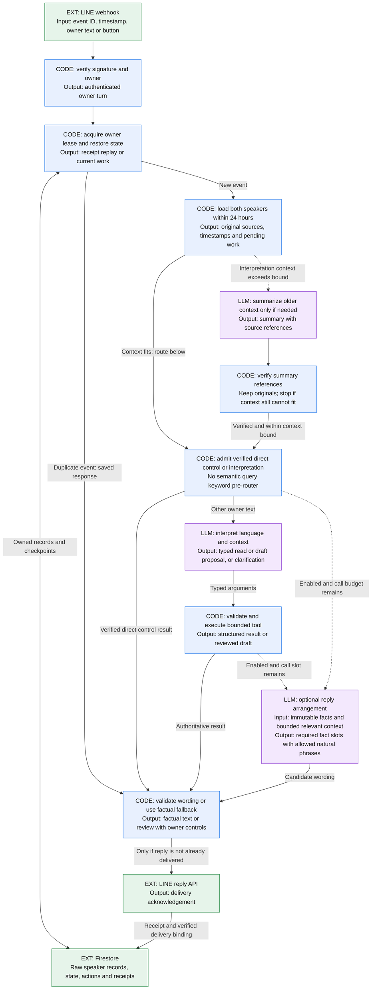
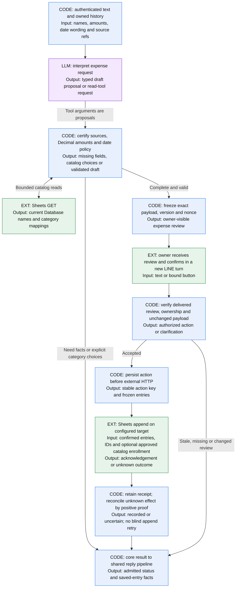
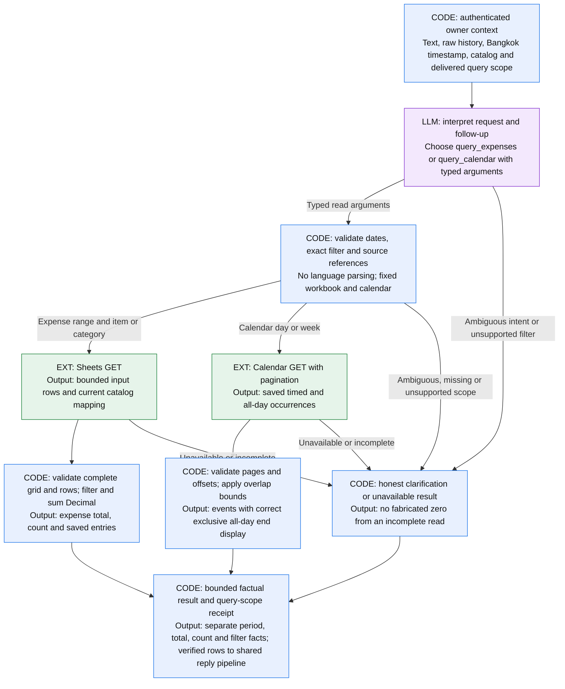

# Runtime flow: inputs, decisions and outputs

This page describes the signed, history-enabled application. **Deployment status:** these diagrams describe this source revision; its LLM-selected query changes require a separate deployment. Publishing a later source change or passing CI does not deploy it automatically. The local mock and older compatibility entry points are separate compositions.

**Legend:** blue **CODE** = deterministic Python; purple **LLM** = a conditional request to the configured model; green **EXT** = LINE, Google or storage. Arrow labels name the data crossing a boundary. Each diagram is one view of the same application, not a sequence of mandatory model calls.

## 1. Shared ingress, history and reply

History includes original owner messages and delivered assistant replies. A rolling 24-hour context window does not delete stored originals. The interpretation request carries owner source references, message timestamps, draft views and date references. Verified older-context summaries are conditional; the system stops rather than silently clipping required context.

All LLM roles use the configured model, with **at most two provider calls per owner turn in total**. A verified direct control can use zero interpretation calls. Stored-data queries use one interpretation call and, when enabled with a slot remaining, one grounded wording call. A proposal may need another tool-result step. General conversation can return plain interpretation text without any business tool. Optional wording runs only when enabled and a call slot remains; a failed, rejected or slow response uses the code-produced message. Wording receives admitted facts and short relevant snippets, not the full interpretation history, and cannot call business tools.

## 2. Expense write: proposal, review, then effect

For a new expense with no date, **code uses Bangkok today** from the original owner message timestamp. Unchanged edits retain the certified date; ambiguous or conflicting dates require clarification. The server resolves existing catalog labels; a new item requires the owner's category/subcategory choices before a review. An LLM tool call never grants write permission. Income has no verified storage mapping and is unsupported; it is not a known zero balance.

Confirmation is another authenticated turn through the shared ingress. Named buttons/text bind the frozen review; a short contextual acknowledgement must refer to the appropriate delivered review. Queries create no consent. After an action starts, durable keys and receipts prevent duplicate webhook effects, and uncertain outcomes preserve the original intent until reconciliation proves what happened.

## 3. Calendar write: explicit timing and one configured calendar

Calendar creation does not invent a missing clock or duration. A dated request without timing asks all-day versus start time; an all-day request never needs clock fields. Single-date all-day creation uses `start.date` and the **exclusive next-day** `end.date`. Timed payloads carry explicit offsets. Group reviews retain each event's facts, and partial/uncertain writes retain per-event recovery state. Draft cancellation does not delete saved events. A terse dated title can ask add-versus-read intent before any draft proposal.

## 4. Stored-data queries: LLM chooses scope, code reads and calculates

There is no semantic keyword pre-router for queries. The LLM chooses typed calendar frames or explicit dates, filter and total/list mode from the current text and trusted context; it clarifies ambiguity. Code expands model-selected relative calendar frames, validates the typed range and exact catalog identity, performs complete reads and calculates every amount. The old competing `spending_summary` is absent from the raw planner tool set; compatibility applications retain their separate legacy contract. Expense queries use inclusive local dates and the **current** catalog mapping. Calendar queries cover at most seven dates and three pages of 20 events; unfinished pagination yields an unavailable response. Complete replies show at most 20 rows and disclose additional results. Saved all-day events can span several dates even though new all-day creation is single-date only.

A complete empty read can report zero saved records. It does not establish availability in another calendar, income or a remaining balance. Reads create no business write, action, draft or nonce; normal conversation receipts and usage records still persist. Provider reads are bounded but are not a transactionally frozen snapshot across external edits. See [query examples and limits](read-queries.md).

## Boundary inputs and outputs

| Boundary | Input | Output | Decides or performs |
| --- | --- | --- | --- |
| Signed ingress | LINE event, original timestamp, text/button | Verified owner turn or rejection | Code |
| History/context | Both speakers, pending state, original source refs | 24-hour context; verified older summary when needed | Code; conditional LLM summary |
| Interpretation | Current owner text, history, typed tool definitions | Proposed fields/tool call or text | LLM; never write consent |
| Validation/review | Proposed fields and trusted catalog/provider reads | Certified draft, exact review or clarification | Code |
| Confirmation/effect | Delivered review binding and fresh owner action | Stable durable action; provider receipt or uncertainty | Code and fixed external service |
| Stored-data read | Raw owner question/history and trusted current clock/catalog | LLM-selected typed scope, then calculated total/count/list or reason-coded error | LLM interpretation; code and GET-only provider path |
| Reply realization | Admitted facts, short relevant context, remaining call budget | Validated factual wording or original code fallback | Conditional LLM, then code |
| Persistence/delivery | Core result, action state, LINE acknowledgement | Durable receipt, delivery binding and retained originals | Code, Firestore and LINE |

## Source and prompt map

| Purpose | Source |
| --- | --- |
| Signed composition and flags | [`history_cloud_run.py`](../src/line_assistant/history_cloud_run.py), [`main.py`](../src/line_assistant/main.py) |
| Routing, tool loop, review and consent | [`history_first.py`](../src/line_assistant/history_first.py), [`draft_workflow.py`](../src/line_assistant/draft_workflow.py) |
| Interpretation and overflow-summary prompts | [`raw_history.py`](../src/line_assistant/raw_history.py): `RAW_INSTRUCTIONS`, `CALENDAR_INSTRUCTIONS`, `SUMMARY_INSTRUCTIONS`; raw sources remain authoritative |
| Expense evidence and date defaults | [`expense_sources.py`](../src/line_assistant/expense_sources.py), [`expense_evidence.py`](../src/line_assistant/expense_evidence.py), [`history_dates.py`](../src/line_assistant/history_dates.py) |
| Calendar normalization, groups and consent | [`calendar_dates.py`](../src/line_assistant/calendar_dates.py), [`calendar_workflow.py`](../src/line_assistant/calendar_workflow.py), [`calendar_batches.py`](../src/line_assistant/calendar_batches.py) |
| Typed read tools, validation, natural fallback and fixed adapters | [`read_queries.py`](../src/line_assistant/read_queries.py), [`sheets_api.py`](../src/line_assistant/sheets_api.py), [`calendar_provider.py`](../src/line_assistant/calendar_provider.py) |
| Wording prompt and factual fallback | [`response_realization.py`](../src/line_assistant/response_realization.py): `INSTRUCTIONS`, fact extraction, strict response schema and validation |
| Transport limits and recovery | [`pilot_http.py`](../src/line_assistant/pilot_http.py), [`calendar_transport.py`](../src/line_assistant/calendar_transport.py), [`firestore_state.py`](../src/line_assistant/firestore_state.py) |
| Raw history and compatible state envelopes | [`raw_history.py`](../src/line_assistant/raw_history.py), [`production_history_state.py`](../src/line_assistant/production_history_state.py), [`history_persistence.py`](../src/line_assistant/history_persistence.py) |

**Maintenance rule:** whenever a runtime route, model phase, provider effect or input/output contract changes, update the affected diagram, boundary table and module links in the same source change. Keep the README's main-function list and [overview SVG](assets/assistant-overview.svg) aligned with that flow, and check the image at normal README and mobile widths. Keep deployment-status statements aligned with the separately verified live release. Examples must stay synthetic; omit private identifiers, configuration, credentials and operation logs.
