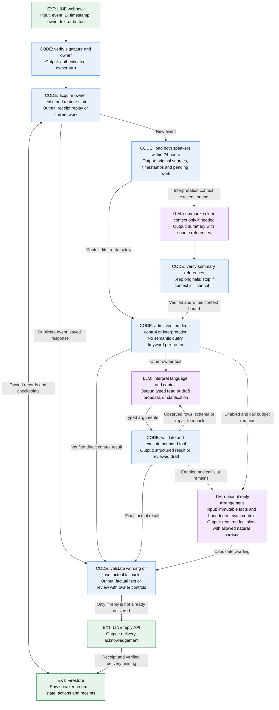
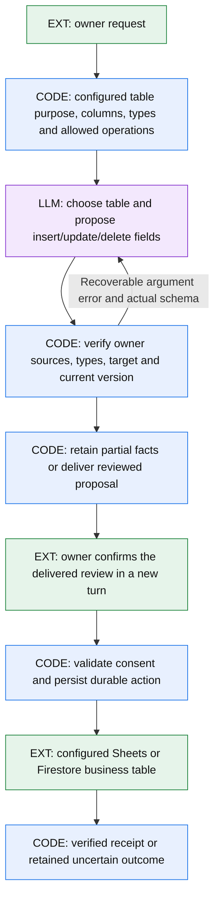
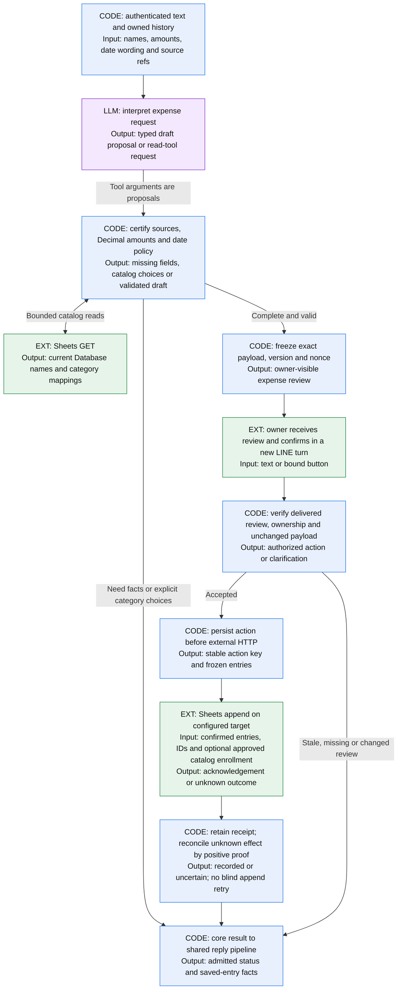
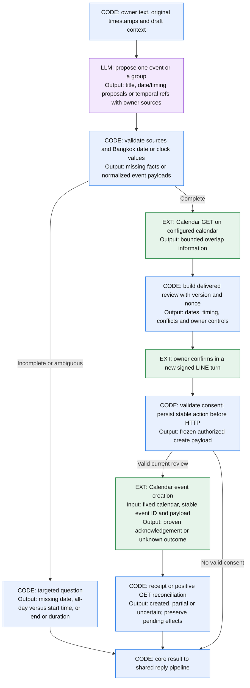
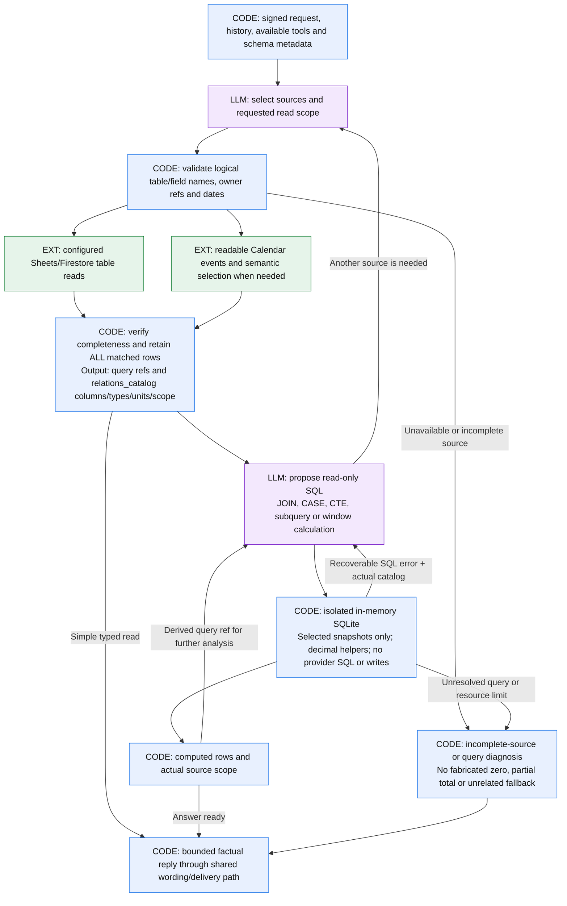

# Runtime flow: inputs, decisions and outputs

This page describes the signed, history-enabled application. **Deployment status:** these diagrams describe this source revision; its SQL/table/temporal changes require a separate deployment. Publishing a later source change or passing CI does not deploy it automatically. The local mock and older compatibility entry points are separate compositions.

**Legend:** blue **CODE** = deterministic Python; purple **LLM** = a conditional request to the configured model; green **EXT** = LINE, Google or storage. Arrow labels name the data crossing a boundary. Each diagram is one view of the same application, not a sequence of mandatory model calls.

## 1. Shared ingress, history and reply

History includes original owner messages and delivered assistant replies. A rolling 24-hour context window does not delete stored originals. The interpretation request carries owner source references, message timestamps, draft views and date references. Verified older-context summaries are conditional; the system stops rather than silently clipping required context.

The development-only critic benchmark is separate from this runtime flow: it can add one two-second Luna review after exact validation, with a trusted fallback on rejection or timeout. Its frozen two-call baseline remains historical benchmark evidence; see the [benchmark protocol](../benchmarks/PROTOCOL.md).

All runtime LLM roles use the configured model. The raw-history path has **no fixed provider-call count per owner turn**. A verified direct control can use zero interpretation calls. A simple stored-data query normally uses interpretation and optional grounded wording. Multi-step read analysis can continue across table, Expense and Calendar results, including SQL analysis, with a complete call/result transcript and read-only tools. Repeated reads stop rather than executing again. Provider/context/output bounds, request deadlines, replay protections and configured accounting gates remain. A proposal may need another tool-result step; optional wording is no longer suppressed just because two core requests ran. Failed or slow wording uses the code-produced message and cannot call business tools.

## 2. Structured-record writes: metadata, proposal and confirmation

People, income, shopping and other configured schemas use the same table tools.
Fields do not implicitly require a date or amount. New ordinary schemas use
metadata plus an existing supported storage binding. Missing/ambiguous routing
asks which table to use. SQL never enters this mutation path.

Shared pending-record patches retain unchanged fields and their original
proofs. Semantic temporal plans compute normalized values from owner wording
and verified bases. Neither tool grants final consent. See
[table changes](tables.md), [pending patches](pending-records.md) and
[temporal plans](temporal-plans.md).

### Expense-specific workflow: catalog and evidence

For a new expense with no date, **code uses Bangkok today** from the original owner message timestamp. Unchanged edits retain the certified date; ambiguous or conflicting dates require clarification. The server resolves existing catalog labels; a new item requires the owner's category/subcategory choices before a review. An LLM tool call never grants write permission. This expense ledger does not store income. Income requires a separately configured table; an absent income source is not a known zero balance.

When [previous-amount suggestions](previous-expense-prices.md) are enabled, a
missing amount can trigger a complete bounded saved-history read. Code selects
an exact item's reliable latest past-day total and displays its source date;
the model can propose its owned reference only after the owner chooses it.
The new expense date remains independent. Source fingerprints are checked again
before review confirmation and the first append attempt. The ordinary delivered
review, separate consent and reconciliation path still control the write.

Confirmation is another authenticated turn through the shared ingress. Named buttons/text bind the frozen review; a short contextual acknowledgement must refer to the appropriate delivered review. Queries create no consent. After an action starts, durable keys and receipts prevent duplicate webhook effects, and uncertain outcomes preserve the original intent until reconciliation proves what happened.

## 3. Calendar write: explicit timing and one configured calendar

Calendar creation does not invent a missing clock or duration. A dated request without timing asks all-day versus start time; an all-day request never needs clock fields. Single-date all-day creation uses `start.date` and the **exclusive next-day** `end.date`. Timed payloads carry explicit offsets. Group reviews retain each event's facts, and partial/uncertain writes retain per-event recovery state. Draft cancellation does not delete saved events. A terse dated title can ask add-versus-read intent before any draft proposal.

## 4. Stored-data analysis: source reads, then SQL

`query_relations` is the main composable analysis tool. The planner first reads
necessary sources with `query_table`, `query_expenses` or `query_calendar` and
`continue_analysis=true`. Actual matched rows, logical columns, units and scope
become current-request relations. A display of20 rows does not restrict the
records used for SQL. Results can become derived relations for further queries.
Simple typed reads and legacy `finish_query_analysis` combinations remain
available; SQL is not mandatory for every question.

Python executes SELECT/CTEs over a new in-memory SQLite connection, with
extensions disabled, an authorizer and resource bounds. It cannot query provider
SQL endpoints, files, unconfigured tables or internal workflow collections.
It cannot prepare or confirm a write. Model SQL expresses the requested
semantics; execution checks sources and computation, not the correctness of
that interpretation. Decimal sums/helpers and explicit rounding handle numeric
analysis; see [precision and SQL details](relational-queries.md).

For activity spending, a complete Calendar selection can constrain payment
dates. EXISTS over Bangkok start/last dates avoids multiplying a payment when
appointments overlap. Same-day spending is not proof of costs caused by an
event. Uncertain event membership, missing columns or incomplete inputs cannot
be promoted to complete totals. A query failure cannot be replaced by the
original different read result. Derived refs expire at the end of the turn.

Source limits still apply: legacy expense reads cover up to367 dates; each
Calendar read covers at most31 dates with bounded pagination/semantic inference.
Configured table scans retain their capacity and snapshot contracts. A larger
question can use several reads without a fixed turn-call ceiling. Separate
external reads are not one cross-provider transaction. The planner must choose
coverage, join and deduplication semantics explicitly. Reads create no business
write, review nonce or action; ordinary history/usage receipts still persist.
See [source-read contracts](read-queries.md) and [tables](tables.md).

## Saved-record changes

See the [saved-record flow diagram and provider limits](saved-record-edits.md). Dedicated find/propose tools are available only with explicit feature flags. They retain stable IDs and provider versions on the server; the model receives opaque candidate references. A new signed owner confirmation of the latest delivered before/after review creates the durable Action. Calendar PATCH requires the reviewed ETag; expense edits require fresh ID/input checks and a reviewed policy for other writers. Uncertain effects are reconciled by reads and never automatically reissued. The same-image OFF bridge preserves pending work and raw history while denying new mutations.

## Provisional category suggestions

The [provisional category diagram](provisional-categories.md) adds a separate optional proposal step after a complete category query reports missing mappings. The model suggests bounded existing category pairs; code checks names, ambiguity and exact amounts. Confirmed and proposed subtotals remain separate. Explicit owner consent either includes proposals only in that query or, separately, adds reviewed mappings through a durable fenced Database action. An uncertain mapping write is never automatically repeated.

## Boundary inputs and outputs

| Boundary | Input | Output | Decides or performs |
| --- | --- | --- | --- |
| Signed ingress | LINE event, original timestamp, text/button | Verified owner turn or rejection | Code |
| History/context | Both speakers, pending state, original source refs | 24-hour context; verified older summary when needed | Code; conditional LLM summary |
| Interpretation | Current owner text, history, typed tool definitions | Proposed fields/tool call or text | LLM; never write consent |
| Validation/review | Proposed fields and trusted catalog/provider reads | Certified draft, exact review or clarification | Code |
| Confirmation/effect | Delivered review binding and fresh owner action | Stable durable action; provider receipt or uncertainty | Code and fixed external service |
| Stored-data read | Owner question, schema and current source scope | Complete matched rows and actual relation metadata, or incomplete-read diagnosis | LLM plans; configured read-only provider paths |
| SQL analysis | Selected current-request refs and proposed SELECT/CTE | Computed rows, derived ref and source scope, or query diagnosis | LLM proposes semantics; Python/SQLite executes |
| Reply realization | Admitted facts, short relevant context, remaining call budget | Validated factual wording or original code fallback | Conditional LLM, then code |
| Persistence/delivery | Core result, action state, LINE acknowledgement | Durable receipt, delivery binding and retained originals | Code, Firestore and LINE |

## Source and prompt map

| Purpose | Source |
| --- | --- |
| Signed composition and flags | [`history_cloud_run.py`](../src/line_assistant/history_cloud_run.py), [`main.py`](../src/line_assistant/main.py) |
| Routing, tool loop, review and consent | [`history_first.py`](../src/line_assistant/history_first.py), [`draft_workflow.py`](../src/line_assistant/draft_workflow.py) |
| Interpretation and overflow-summary prompts | [`raw_history.py`](../src/line_assistant/raw_history.py): `RAW_INSTRUCTIONS`, `CALENDAR_INSTRUCTIONS`, `SUMMARY_INSTRUCTIONS`; raw sources remain authoritative |
| Expense evidence and date defaults | [`expense_sources.py`](../src/line_assistant/expense_sources.py), [`expense_evidence.py`](../src/line_assistant/expense_evidence.py), [`history_dates.py`](../src/line_assistant/history_dates.py) |
| Calendar normalization, groups and consent | [`calendar_dates.py`](../src/line_assistant/calendar_dates.py), [`calendar_workflow.py`](../src/line_assistant/calendar_workflow.py), [`calendar_batches.py`](../src/line_assistant/calendar_batches.py) |
| Expense/Calendar source reads and simple direct answers | [`read_queries.py`](../src/line_assistant/read_queries.py), [`sheets_api.py`](../src/line_assistant/sheets_api.py), [`calendar_provider.py`](../src/line_assistant/calendar_provider.py) |
| SQL relation metadata and isolated executor | [`relational.py`](../src/line_assistant/relational.py), [`relational_sql.py`](../src/line_assistant/relational_sql.py) |
| Generic table metadata, source adapters and reviewed CRUD | [`tables.py`](../src/line_assistant/tables.py), [`table_workflow.py`](../src/line_assistant/table_workflow.py), [`table_storage.py`](../src/line_assistant/table_storage.py) |
| Pending updates, temporal plans and adaptive repair | [`pending_records.py`](../src/line_assistant/pending_records.py), [`temporal.py`](../src/line_assistant/temporal.py), [`tool_repair.py`](../src/line_assistant/tool_repair.py) |
| Wording prompt and factual fallback | [`response_realization.py`](../src/line_assistant/response_realization.py): `INSTRUCTIONS`, fact extraction, strict response schema and validation |
| Transport limits and recovery | [`pilot_http.py`](../src/line_assistant/pilot_http.py), [`calendar_transport.py`](../src/line_assistant/calendar_transport.py), [`firestore_state.py`](../src/line_assistant/firestore_state.py) |
| Raw history and compatible state envelopes | [`raw_history.py`](../src/line_assistant/raw_history.py), [`production_history_state.py`](../src/line_assistant/production_history_state.py), [`history_persistence.py`](../src/line_assistant/history_persistence.py) |

**Maintenance rule:** whenever a runtime route, model phase, provider effect or input/output contract changes, update the affected diagram, boundary table and module links in the same source change. Keep the README's capability list and [overview SVG](assets/assistant-overview.svg) aligned with that flow, and check the image at normal README and mobile widths. Keep deployment-status statements aligned with the separately verified live release. Examples must stay synthetic; omit private identifiers, configuration, credentials and operation logs.
